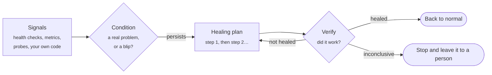

<p align="center">
  <picture>
    <source media="(prefers-color-scheme: dark)" srcset="assets/banner-dark.png">
    
  </picture>
</p>

<p align="center">
  <a href="https://www.nuget.org/packages/Homeostat"></a>
  <a href="https://github.com/engineering87/Homeostat/actions/workflows/ci.yml"></a>
  <a href="https://github.com/engineering87/Homeostat/actions/workflows/codeql.yml"></a>
  <a href="https://scorecard.dev/viewer/?uri=github.com/engineering87/Homeostat"></a>
  
  <a href="LICENSE"></a>
</p>

<p align="center">
  <b>Your application notices when something stays broken, fixes it, and checks that the fix worked.</b><br>
  Safe by default, <a href="docs/performance.md">lightweight</a>, and configured through dependency injection.
</p>

<p align="center">
  <a href="docs/getting-started.md">Getting started</a> ·
  <a href="docs/concepts.md">Concepts</a> ·
  <a href="docs/packages.md">Packages</a> ·
  <a href="docs/recipes.md">Recipes</a> ·
  <a href="docs/faq.md">FAQ</a> ·
  <a href="docs/README.md">All docs</a>
</p>

---

Retries and circuit breakers keep a single call alive while a dependency misbehaves. Homeostat works one level
above: it watches the whole application, decides when a problem is real rather than a blip, runs a guarded
healing plan, and verifies the outcome before doing anything more.



## Quick start

Homeostat is a release candidate: add `--prerelease` until 1.0.0 is published.

```bash
dotnet add package Homeostat --prerelease
dotnet add package Homeostat.HealthChecks --prerelease
```

A complete ASP.NET Core application: a health check reports a stuck weather feed, and Homeostat renews the client
when the problem lasts 30 seconds, then falls back to cached forecasts if renewing did not help.

```csharp
using Homeostat;
using Homeostat.Healing;
using Microsoft.Extensions.Diagnostics.HealthChecks;

var builder = WebApplication.CreateBuilder(args);

builder.Services.AddSingleton<WeatherFeedClient>();
builder.Services.AddHealthChecks().AddCheck<WeatherFeedHealthCheck>("weather-feed");

builder.Services.AddHomeostat(h => h
    .AddHealthCheckSignals(o => o.Period = TimeSpan.FromSeconds(10))  // health check results become signals
    .AddCondition("weather-feed-down", c => c
        .ForSource("weather-feed")                         // the health check's name
        .SustainedFor(TimeSpan.FromSeconds(30))            // ignore short blips
        .Heal(p => p
            .With<RenewFeedClientAction>()                 // try this first
            .TurnOnSwitch("serve-cached-forecast"))));  // then degrade gracefully

var app = builder.Build();
app.Run();

public sealed class WeatherFeedClient
{
    public bool IsStuck { get; set; }

    public void Renew() => IsStuck = false;
}

public sealed class WeatherFeedHealthCheck(WeatherFeedClient client) : IHealthCheck
{
    public Task<HealthCheckResult> CheckHealthAsync(HealthCheckContext context, CancellationToken cancellationToken = default)
        => Task.FromResult(client.IsStuck ? HealthCheckResult.Unhealthy("The feed is stuck.") : HealthCheckResult.Healthy());
}

// An action is a plain class resolved from dependency injection.
public sealed class RenewFeedClientAction(WeatherFeedClient client) : IHealingAction
{
    public Task ExecuteAsync(HealingContext context, CancellationToken cancellationToken)
    {
        client.Renew();
        return Task.CompletedTask;
    }
}
```

Homeostat starts in **dry-run**: it decides and logs, but acts on nothing.

```text
warn: Condition weather-feed-down is active (source weather-feed, severity Unhealthy).
warn: [dry-run] Condition weather-feed-down: step 1/2 would execute RenewFeedClientAction.
warn: [dry-run] Condition weather-feed-down: step 2/2 would execute Turn on switch 'serve-cached-forecast'.
```

When the decisions look right, let it act:

```csharp
builder.Services.AddHomeostat(h => h.Configure(o => o.DryRun = false));
```

Not sure where to start? One line registers the usual detectors (thread pool, memory, exceptions, server errors and
latency) with an observe-only condition for each, ready for a plan when you have seen them in action
([starter presets](docs/detectors.md#starter-presets)):

```csharp
builder.Services.AddHomeostat(h => h.AddWebApiDefaults());   // AddWorkerDefaults() in a worker service
```

The [getting started guide](docs/getting-started.md) walks through this step by step, and
[`samples/`](samples) has a web API and a worker service ready to run. Project templates are available with
`dotnet new install Homeostat.Templates::1.0.0-rc.1`.

## What it covers

- **Signals in**: starter presets for web APIs and workers, health checks, any `System.Diagnostics.Metrics` instrument
  (the OpenTelemetry metrics API), event counters, runtime detectors (thread pool starvation, memory pressure,
  exception rate, stopped workers), HTTP and gRPC clients, Entity Framework Core commands, call signals for any other
  client (an SDK, a TCP protocol), Polly circuit breakers, database and Redis probes, connection pools, message broker
  backlogs, lag and dead letters, alerts from Prometheus Alertmanager, Grafana and Azure Monitor, and any number your
  code can fetch.
- **Decisions**: thresholds, sustained problems, hysteresis, trends, predictions ("full in two hours"), anomalies,
  daily and weekly seasonality, intermittent problems, combinations of conditions, causes that suppress their
  symptoms. Conditions can live in `appsettings.json` and change at runtime.
- **Actions out**: your own action classes and lambdas; switches for degraded modes and feature flags; restarting a
  worker; reloading configuration; clearing connection pools and caches; pausing message consumers; isolating a
  circuit; restarting a pod, scaling a deployment or restarting an Azure App Service, with approval by default.
- **Operations**: status and control endpoints, an embedded dashboard, approvals from the dashboard, Slack and
  Microsoft Teams, notifications to webhooks, PagerDuty and Opsgenie, a JSON Lines audit log, OpenTelemetry traces
  and metrics, a command-line tool, state shared across instances through Redis, plans that run once per cluster.
- **Confidence**: a test host with simulated time, fault injection for game days, coverage reports, and signal
  recordings replayed offline against new rules.

## Packages

Reference only what you use. Every package targets .NET 10.

| Package | Adds |
|---|---|
| `Homeostat` | Engine, conditions, healing plans, guardrails, runtime detectors, starter presets, call signals for any client, built-in actions, switches, approvals, audit log, file store, build-time analyzers |
| `Homeostat.HealthChecks` | Health check results as signals; Homeostat's own health check |
| `Homeostat.AspNetCore` | Status, control and history endpoints, dashboard, Slack and Teams approvals, alert ingestion |
| `Homeostat.Http` | Failure ratio and latency of `IHttpClientFactory` clients; webhook, Slack, Teams, PagerDuty and Opsgenie notifiers |
| `Homeostat.Grpc` | Failure ratio and latency of gRPC clients, judged on the gRPC status, streaming calls included |
| `Homeostat.Polly` | Polly v8 circuit breakers as signals, circuit isolation, chaos enabled by switches |
| `Homeostat.Data` | Database probes for any ADO.NET provider, SqlClient and Npgsql pool signals, connection pool reset |
| `Homeostat.EntityFrameworkCore` | Failure ratio and latency of the commands of a `DbContext`, connectivity probe |
| `Homeostat.Redis` | Shared state and once-per-cluster plans; Redis health signals |
| `Homeostat.Caching` | Memory cache hit ratio; HybridCache, distributed and memory cache purge actions |
| `Homeostat.MongoDB` | Ping, primary availability, pool exhaustion and replication lag |
| `Homeostat.ServiceBus`, `.RabbitMQ`, `.Kafka`, `.Artemis` | Backlog, dead letters, consumers and lag; consumers that plans pause and resume |
| `Homeostat.FeatureManagement`, `.OpenFeature` | Feature flags driven by Homeostat switches |
| `Homeostat.Kubernetes`, `.Azure` | Pod, deployment and node actions; App Service, virtual machine and Front Door actions |
| `Homeostat.Aspire.Hosting` | A dashboard link and Pause/Resume healing commands in the .NET Aspire dashboard |
| `Homeostat.Testing` | Test host with simulated time, fault injection, offline replay |
| `Homeostat.Cli` | The `homeostat` tool: status, history, approvals, switches, coverage, replay |
| `Homeostat.Templates` | `dotnet new homeostat-webapi` and `homeostat-worker` |

The [package index](docs/packages.md) lists the install command and entry points of each one.

## Safe by default

| Guardrail | Default | What it prevents |
|---|---|---|
| Dry-run | **on** | Acting before you have seen what it would do |
| Action budget | 10 steps per hour, all plans together | A faulty check causing a storm of fixes |
| Cooldown | 5 minutes per plan, with optional backoff | The same plan looping |
| Concurrency | 1 run at a time | Two plans acting on the system together |
| Step timeout | 30 seconds | A stuck step holding up the run |
| Verification | after every step | Escalating blindly, or stopping without knowing |
| Kill switch | `POST /homeostat/pause`, the dashboard, the CLI or `IHomeostatControl.PauseAsync()`; with a shared store, for every instance | Interventions during an incident or maintenance |
| Approval | per step, on by default for infrastructure actions | Risky steps running without a person agreeing |
| Suppression | per condition | Healing the symptoms of a failure instead of its cause |
| Fail closed | always | Acting when the cooldown or budget cannot be checked |

Details in [Guardrails](docs/guardrails.md) and [Security hardening](docs/security.md).

## How it compares

| | Polly / `Microsoft.Extensions.Resilience` | Kubernetes probes and restart policies | Homeostat |
|---|---|---|---|
| Scope | One call | One container | The whole application and its dependencies |
| Reacts to | An exception or timeout, right now | A failing liveness or readiness probe | A problem that **persists**, from any signal |
| Typical action | Retry, timeout, circuit breaker, fallback, hedging | Restart the container, stop routing traffic | Renew a client, clear a pool, degrade, fail over, pause consumers, and restart only as a last resort |
| After acting | Returns a result to the caller | Restarts again if the probe keeps failing | **Verifies** recovery, escalates or stops, and keeps a record |

They work well together. With `Homeostat.Polly`, a circuit breaker that stays open becomes a signal, so Homeostat
can step in where retries are no longer enough; with `Homeostat.Kubernetes`, a pod restart becomes the last,
approved step of a plan instead of the first reaction.

## Production readiness

- **Platforms**: .NET 10 (LTS). CI builds and tests on Linux; Windows and macOS are expected to work. See
  [Platforms](docs/platforms.md) for the minimum versions of the client libraries.
- **Overhead**: publishing a signal costs well under a microsecond and processing it does not allocate; see the
  [measurements](docs/performance.md).
- **Trimming and Native AOT**: the libraries (except `Homeostat.Aspire.Hosting` and `Homeostat.EntityFrameworkCore`)
  are marked trimming and AOT compatible; CI publishes and runs a Native AOT application that uses the core, ASP.NET Core, health check, HTTP,
  caching, Kubernetes and Azure packages ([details](docs/native-aot.md)).
- **Stable API**: the public API of every library package is recorded in [`api/`](api) and checked by a test. From 1.0 the
  project follows Semantic Versioning ([versioning policy](docs/versioning.md)).
- **Supply chain**: releases carry an SBOM and build provenance; every CI action is pinned to a commit
  ([SECURITY.md](SECURITY.md)); CodeQL analyzes the C# code and the workflows on every pull request.

Start in dry-run, then turn on actions one condition at a time.

## Documentation

The [documentation index](docs/README.md) is organized as a path: [getting started](docs/getting-started.md),
[concepts](docs/concepts.md), then reference pages for signals, conditions, healing plans, actions, guardrails,
integrations, message brokers, cloud actions, endpoints, notifications, observability, configuration and testing,
and [recipes](docs/recipes.md) for common scenarios.

## Status

Homeostat `1.0.0-rc.1` is a release candidate: the API is expected to be final, and changes before 1.0.0 will be
limited to fixes found while it is tried. The [roadmap](docs/ROADMAP.md) lists what comes after 1.0.
Questions, feedback and ideas are welcome in the [issues](https://github.com/engineering87/Homeostat/issues).

## Contributing

Contributions are welcome: read [CONTRIBUTING.md](CONTRIBUTING.md) and the [code of conduct](CODE_OF_CONDUCT.md)
first. Report vulnerabilities privately, as described in [SECURITY.md](SECURITY.md).

## Background

Homeostat builds on ideas its author explores in the book
[*Designing Self-Healing Systems with .NET*](https://link.springer.com/book/9798868831768) (Apress, 2026).
It is an independent project: it is not the book's companion code, and it does not require the book.

## License

[MIT](LICENSE) © Francesco Del Re
