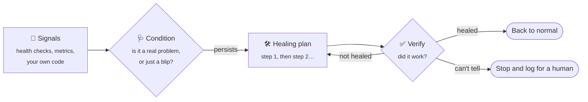

<p align="center">
  <picture>
    <source media="(prefers-color-scheme: dark)" srcset="assets/banner-dark.png">
    
  </picture>
</p>

<p align="center">
  <a href="https://www.nuget.org/packages/Homeostat"></a>
  <a href="https://www.nuget.org/packages/Homeostat"></a>
  <a href="https://github.com/engineering87/Homeostat/actions/workflows/ci.yml"></a>
  
  <a href="LICENSE"></a>
</p>

<p align="center">
  <b>Your application notices when something stays broken, fixes it, and checks that the fix worked.</b><br>
  Lightweight, safe by default, and wired in with a few lines of dependency injection.
</p>

<p align="center">
  <a href="docs/getting-started.md">Getting started</a> ·
  <a href="docs/concepts.md">Concepts</a> ·
  <a href="docs/recipes.md">Recipes</a> ·
  <a href="docs/faq.md">FAQ</a> ·
  <a href="docs/README.md">All docs</a>
</p>

---

## The idea in one picture



Retries and circuit breakers keep a single request alive while a dependency misbehaves.
**Homeostat works one level above**: it watches the whole application, decides when a problem is
real, runs a remediation plan and **verifies** the outcome before doing anything more.

## A quick look

```csharp
builder.Services.AddHealthChecks()
    .AddCheck<WeatherFeedHealthCheck>("weather-feed");

builder.Services
    .AddHomeostat(h => h
        .AddCondition("weather-feed-down", c => c
            .ForSource("weather-feed")                 // listen to this health check
            .SustainedFor(TimeSpan.FromSeconds(30))    // ignore short blips
            .Heal(p => p
                .With<RenewFeedClientAction>()         // try this first
                .Then<SwitchToBackupProviderAction>()))) // escalate only if needed
    .AddHealthCheckSignals();
```

An action is a plain class resolved from dependency injection:

```csharp
public sealed class RenewFeedClientAction(WeatherFeedClient client) : IHealingAction
{
    public Task ExecuteAsync(HealingContext context, CancellationToken cancellationToken)
    {
        client.Renew();
        return Task.CompletedTask;
    }
}
```

That's it. Out of the box Homeostat runs in **dry-run** and only logs what it would do:

```text
warn: Condition weather-feed-down is active (source weather-feed, severity Unhealthy).
warn: [dry-run] Condition weather-feed-down: step 1/2 would execute RenewFeedClientAction.
warn: [dry-run] Condition weather-feed-down: step 2/2 would execute SwitchToBackupProviderAction.
```

Dry-run lists every step of the plan; in a real run, later steps run only when escalation is needed.
When the decisions look right, set `DryRun = false` and let it act.
👉 Follow the [5-minute tutorial](docs/getting-started.md).

### Batteries included

No signals to write, no action classes needed for the common cases:

```csharp
builder.Services.AddHttpClient("forecast")
    .AddHomeostatSignals();                            // failure ratio and latency of this client

builder.Services.AddHomeostat(h => h
    .AddThreadPoolStarvationDetector()                 // runtime detectors
    .AddMemoryPressureDetector()
    .AddDatabaseProbe("catalog-db", _ => new SqlConnection(catalogDb))      // database round trip
    .AddProbe("ingest-backlog", async (sp, ct) => await sp.GetRequiredService<IngestQueue>().CountAsync(ct),
        p => p.UnhealthyAbove = 10_000)                // any number you can fetch
    .AddCondition("forecast-api-failing", c => c
        .ForSource("http:forecast")
        .SustainedFor(TimeSpan.FromSeconds(30))
        .Heal(p => p
            .With("renew-client", sp => sp.GetRequiredService<ForecastClient>().Renew())  // inline action
            .TurnOnSwitch("serve-cached-forecast", turnOffWhenCleared: true))));  // then: degraded mode
```

### Built for real incidents

```csharp
builder.Services.AddHomeostat(h => h
    .AddCondition("network-down", c => c
        .ForSource("network")
        .Heal(p => p.With<ResetNetworkClientAction>()))
    .AddCondition("forecast-failing", c => c
        .ForSource("http:forecast")
        .SustainedFor(TimeSpan.FromSeconds(30))
        .ClearAfter(TimeSpan.FromMinutes(2))           // recovery must last: no flapping
        .SuppressedBy("network-down")                  // a symptom: heal the cause first
        .Heal(p => p
            .With<RenewForecastClientAction>()
            .Then<FailoverToSecondaryAction>()
                .RequireApproval()))                   // a person says yes before failing over
    .AddWebhookNotifications(o => o.Url = chatWebhook) // the team sees what happens
    .AddAuditLog("logs/homeostat-{date}.jsonl"));      // and there is a record

builder.Services.AddHomeostat(h => h
    .UseRedis("redis:6379")                            // cooldowns, budget, history shared by every instance
    .AddServerErrorRateSignal()                        // 5xx ratio from ASP.NET Core metrics
    .AddCondition("api-errors", c => c
        .ForSource("http-server-errors")
        .SustainedFor(TimeSpan.FromMinutes(1))
        .Heal(p => p
            .With<RecycleDependencyClientsAction>()
            .CooldownBackoff(2, TimeSpan.FromHours(1))   // try less often if it keeps failing
            .OncePerCluster())));                        // one instance acts for all

app.MapHomeostatStatus("operations");                  // GET /homeostat/status
app.MapHomeostatControl("operations");                 // pause, resume, approve (policy required)
```

## What's in the box

| 📡 Signals from | 🩺 Decisions | 🛠️ Actions | 🧰 Operations |
|---|---|---|---|
| Health checks | Thresholds and custom rules | Inline lambdas | Dry-run, budget, cooldown with backoff |
| Any metric (OpenTelemetry / `System.Diagnostics.Metrics`) | Sustained problems only | Action classes with DI | Kill switch, maintenance windows |
| Server error rate and latency | Values, trends, anomalies | Restart a hosted service | File and Redis stores |
| Thread pool, memory, exceptions | Intermittent problems | Reload configuration | Once-per-cluster plans |
| HTTP clients (failures, p95 latency) | Combinations of conditions | Switches with automatic reset | Status and control endpoints |
| Polly circuit breakers | Hysteresis, causes vs symptoms | Compensating actions | Webhooks, audit log, health check |
| Databases, Redis, memory caches | Escalation with verification, human approval | Connection pool reset, cache purge | Conditions from `appsettings.json`, test host |
| Alertmanager, Grafana, Azure Monitor alerts | | Circuit isolation, feature flags | Chaos for game days |
| Probes: queues, lag, any number you can fetch | | | |

## Why Homeostat

<table>
<tr>
<td width="33%" valign="top">

### 🧩 Easy to adopt
One `AddHomeostat` call, ready-made detectors and actions, inline lambdas when you need custom
logic. No base classes, no attributes, no extra infrastructure.

</td>
<td width="33%" valign="top">

### 🛡️ Safe by default
Dry-run on, global action budget, cooldowns, timeouts, one run at a time, a kill switch and human
approval where you want it. It would rather stop and ask than make things worse.

</td>
<td width="33%" valign="top">

### 🔍 Verifies, not hopes
Every completed action is followed by a check: **healed**, **not healed** (escalate) or **inconclusive**
(stop). No blind escalation.

</td>
</tr>
<tr>
<td valign="top">

### ⏱️ Calm under pressure
Conditions activate only when a problem persists, clear only when recovery lasts, and symptoms wait
while their cause is being healed.

</td>
<td valign="top">

### 📈 Observable
Every decision is logged and traced, with OpenTelemetry-ready metrics, a status endpoint, chat
notifications and an audit trail.

</td>
<td valign="top">

### 🧪 Testable
`Homeostat.Testing` runs whole healing scenarios in milliseconds with simulated time, and lets you
unit test every action.

</td>
</tr>
</table>

## Install

```bash
dotnet add package Homeostat
```

| Package | Purpose |
|---|---|
| `Homeostat` | Core engine, runtime detectors, built-in actions, switches, guardrails, approvals, audit log |
| `Homeostat.AspNetCore` | Status and control endpoints; alerts from Alertmanager, Grafana and Azure Monitor as signals |
| `Homeostat.Caching` | Memory cache hit ratio as signals; HybridCache, distributed and memory cache purge actions |
| `Homeostat.Data` | Database probes for any ADO.NET provider; connection pool reset |
| `Homeostat.FeatureManagement` | Feature filter driven by Homeostat switches |
| `Homeostat.HealthChecks` | Health check results as signals; Homeostat's own health check |
| `Homeostat.Http` | Failure ratio and latency of `IHttpClientFactory` clients as signals; webhook notifier |
| `Homeostat.OpenFeature` | OpenFeature provider exposing Homeostat switches as flags |
| `Homeostat.Polly` | Polly v8 circuit breaker state as signals; circuit isolation; chaos enabled by switches |
| `Homeostat.Redis` | State shared by every instance, plans that run once per cluster; Redis client health signals |
| `Homeostat.Testing` | Test host with simulated time, fault injection, helpers for unit tests |

Targets **.NET 10** (LTS, supported until November 2028).

## Safe by default

| Guardrail | Default | What it prevents |
|---|---|---|
| Dry-run | **on** | Acting before you have seen what it would do |
| Action budget | 10 actions / hour | A faulty check causing a storm of fixes |
| Cooldown | 5 minutes per plan | The same plan looping |
| Concurrency | 1 run at a time | Two plans acting on the system together |
| Action timeout | 30 seconds | A stuck action holding up the run (actions must honor the cancellation token) |
| Kill switch | `IHomeostatControl.Pause()` or `POST /homeostat/pause` | Interventions during maintenance |
| Approval | per step, opt-in | Risky steps running without a person agreeing |
| Suppression | per condition, opt-in | Healing the symptoms of a failure instead of its cause |
| Maintenance windows | opt-in | Interventions during planned work |
| Fail closed | always | Acting when the cooldown or budget cannot be checked |

Details in [Guardrails](docs/guardrails.md).

## Homeostat and Polly

They solve different problems and work well together.

| | Polly / `Microsoft.Extensions.Resilience` | Homeostat |
|---|---|---|
| Scope | One call | The whole application |
| Reacts to | An exception or timeout, right now | A problem that **persists** |
| Typical action | Retry, wait, fail fast | Renew a client, fail over, reload configuration |
| After acting | Returns a result to the caller | **Verifies** recovery, escalates or stops |

With `Homeostat.Polly`, a circuit breaker that **stays open** becomes a signal, so Homeostat can step in
where retries are no longer enough.

## Documentation

| | |
|---|---|
| 🚀 [Getting started](docs/getting-started.md) | Build your first self-healing loop in 5 minutes |
| 🧠 [Concepts](docs/concepts.md) | The mental model: signals, conditions, plans, verification |
| 📡 [Signals](docs/signals.md) | Feed observations from health checks or your own code |
| 🔭 [Detectors](docs/detectors.md) | Ready-made signals: thread pool, memory, exceptions, HTTP clients, circuit breakers |
| 🩺 [Conditions](docs/conditions.md) | Decide when a problem is real |
| 🛠️ [Healing plans](docs/healing-plans.md) | Escalation and verification |
| ⚙️ [Actions](docs/actions.md) | Built-in actions, switches, inline lambdas, action classes |
| 🛡️ [Guardrails](docs/guardrails.md) | Every safety mechanism and its defaults |
| 📈 [Observability](docs/observability.md) | Logs, traces, metrics, runtime control and observers |
| 🔔 [Notifications and audit](docs/notifications.md) | Webhook notifier and JSON Lines audit log |
| 🗄️ [Persistence and clusters](docs/persistence-and-clusters.md) | Stores, several instances, once-per-cluster plans |
| 🧾 [Configuration](docs/configuration.md) | Conditions and plans in `appsettings.json`, applied at runtime |
| 🌐 [ASP.NET Core endpoints](docs/aspnetcore.md) | Status and control endpoints, Homeostat as a health check |
| 🧪 [Testing](docs/testing.md) | Scenario tests with simulated time and fault injection |
| 🍳 [Recipes](docs/recipes.md) | Ready-to-adapt solutions for common scenarios |
| ❓ [FAQ & troubleshooting](docs/faq.md) | "Why didn't it act?" and other questions |

A runnable example lives in [`samples/Homeostat.Samples.WeatherFeed`](samples/Homeostat.Samples.WeatherFeed).

## Project status

Homeostat is in **preview** (`0.1.0-preview.1`): the API may change before 1.0.
See the [roadmap](docs/ROADMAP.md) for what is coming next. Feedback and ideas are very welcome in the
[issues](https://github.com/engineering87/Homeostat/issues).

## Contributing

Contributions are welcome. Please read [CONTRIBUTING.md](CONTRIBUTING.md) and the
[code of conduct](CODE_OF_CONDUCT.md) first.

## Background

The ideas behind Homeostat are discussed in depth in the book
[*Designing Self-Healing Systems with .NET*](https://link.springer.com/book/9798868831768) (Apress, 2026).
Homeostat is an independent project: it is not the book's companion code and does not require the book.

## License

[MIT](LICENSE) © Francesco Del Re
