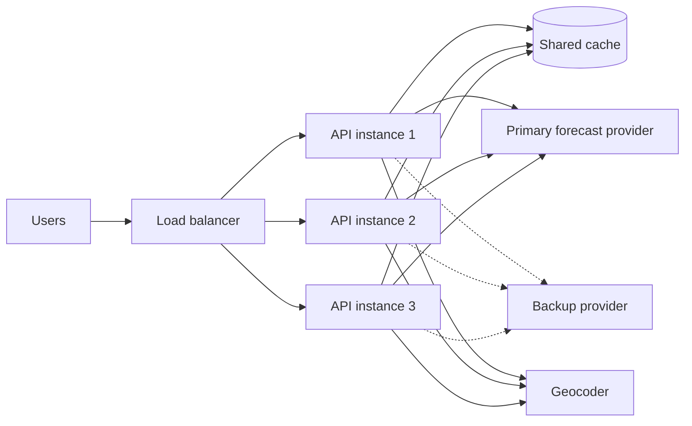
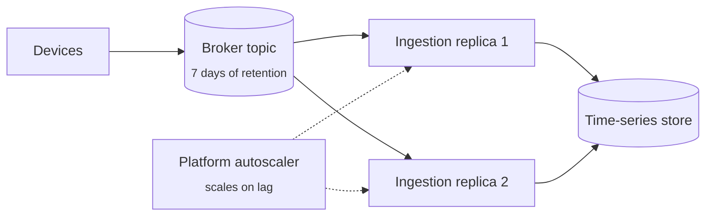
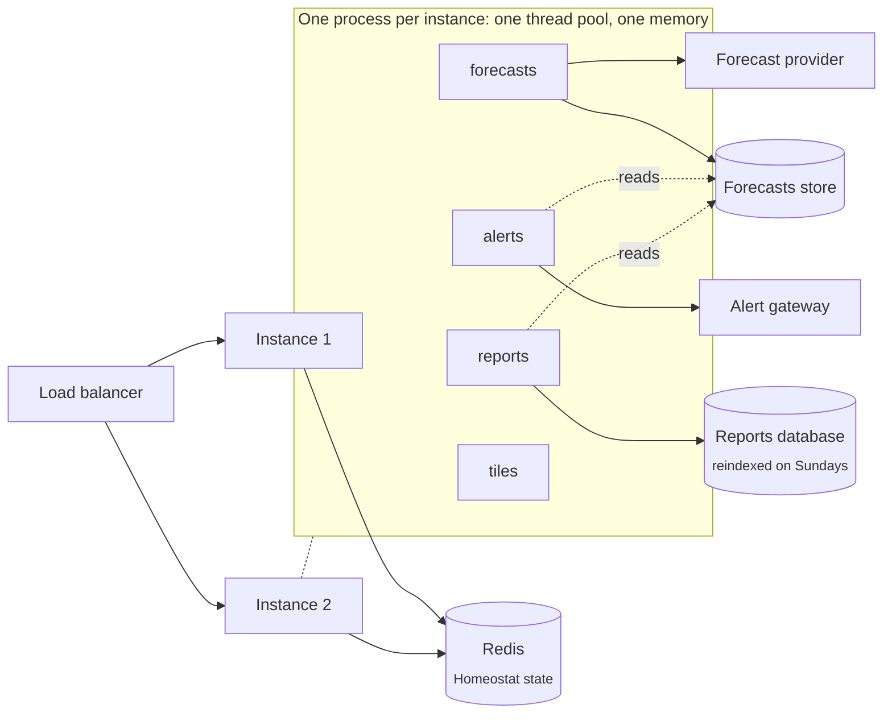

# From your architecture to a configuration

Homeostat runs the loop; the knowledge of your system is yours to write down (see
[Where the knowledge of your architecture goes](concepts.md#where-the-knowledge-of-your-architecture-goes)). This page
shows how that works on three systems. Each example starts from what the team knows, turns every fact into a decision,
and ends with the configuration and the tests that check it.

The examples are not templates. Two systems that look alike can need different plans because the facts behind them
differ: who pays for the backup provider, how long the broker keeps messages, what the platform already does. Copy the
reasoning, not the numbers.

The full code is in [`samples/Homeostat.Samples.Architectures`](https://github.com/engineering87/Homeostat/tree/main/samples/Homeostat.Samples.Architectures), built with
the solution. `ArchitectureExamplesTests` runs each behaviour described below on simulated time, so the page and the
code cannot drift apart.

- [Example 1: a forecast API](#example-1-a-forecast-api)
- [Example 2: a telemetry ingestion service](#example-2-a-telemetry-ingestion-service)
- [Example 3: a modular monolith](#example-3-a-modular-monolith)
- [Writing down your own system](#writing-down-your-own-system)

---

## Example 1: a forecast API

### The system

An ASP.NET Core API answers forecast requests. It runs as three instances behind a load balancer and shares its
Homeostat state through Redis. Forecasts come from a primary provider; a backup provider exists. A shared cache keeps
recent forecasts, and a geocoder turns coordinates into place names.



### What the team knows, and what it decides

| What the team knows | What it decides |
|---|---|
| The primary provider is shared: when it is down, it is down for every instance | Its plan runs `OncePerCluster()`: one decision, and the switches it turns on apply to every instance |
| After a failover no user traffic reaches the primary | The primary is watched by a latency probe on its status endpoint, not through user requests, so the condition can see it come back |
| The provider has short blips (its own deployments) that last under a minute | `SustainedFor(2 minutes)` |
| Going back too early to a provider that is barely up brings the errors back | `ClearAfter(5 minutes)`: the primary must answer for five minutes first |
| A stale forecast is better than an error, and costs nothing | First step: the `serve-stale-forecasts` switch |
| The backup provider uses a different model and is paid per call | Second step: the `use-backup-forecast-provider` switch, with `RequireApproval(15 minutes)` |
| With the cache down, every request reaches the provider, which slows down under that load | `SuppressedBy("forecast-cache-down")`: heal the cache; failing over would only move the load |
| Each instance has its own connection to the cache | `forecast-cache-down` runs on each instance, and bypasses the cache there |
| Place names are a convenience | Hide them; nothing more invasive |
| With the names hidden the geocoder gets no calls, so its signal stops | `HoldAtMost(10 minutes)`: then the names come back, and the next calls tell whether the geocoder recovered |

### The configuration

```csharp
public static HomeostatBuilder AddForecastApiHealing(this HomeostatBuilder h) => h
    // Observe the primary provider directly: after a failover no user traffic reaches it, and only a probe can
    // tell when it is back.
    .AddLatencyProbe("forecast-primary",
        (sp, ct) => sp.GetRequiredService<IForecastProviders>().PingPrimaryAsync(ct),
        p =>
        {
            p.Interval = TimeSpan.FromSeconds(15);
            p.UnhealthyLatency = TimeSpan.FromSeconds(2);
        })
    .AddLatencyProbe("forecast-cache",
        (sp, ct) => sp.GetRequiredService<IForecastCache>().PingAsync(ct),
        p =>
        {
            p.Interval = TimeSpan.FromSeconds(10);
            p.UnhealthyLatency = TimeSpan.FromMilliseconds(500);
        })

    // Each instance has its own connection to the cache: each one decides for itself.
    .AddCondition("forecast-cache-down", c => c
        .ForSource("forecast-cache")
        .SustainedFor(TimeSpan.FromSeconds(30))
        .ClearAfter(TimeSpan.FromMinutes(1))
        .Heal(p => p.TurnOnSwitch(BypassCache)))

    // The provider is shared by every instance: one decision for the whole deployment.
    .AddCondition("forecast-primary-down", c => c
        .ForSource("forecast-primary")
        .SustainedFor(TimeSpan.FromMinutes(2))
        // The primary must answer for 5 minutes before traffic goes back to it.
        .ClearAfter(TimeSpan.FromMinutes(5))
        // With the cache down every request reaches the provider: its slowness is our own load, and failing over
        // would only move that load to the backup.
        .SuppressedBy("forecast-cache-down")
        .Heal(p => p
            // Least invasive first: users get yesterday's data instead of an error.
            .TurnOnSwitch(ServeStaleForecasts)
            // The backup provider has a different model and a cost per call: a person agrees first.
            .TurnOnSwitch(UseBackupProvider).RequireApproval(TimeSpan.FromMinutes(15))
            .OncePerCluster()))

    // Place names are a convenience: hide them rather than fail the forecast.
    .AddCondition("geocoder-down", c => c
        .ForSource("http:geocoder")
        .SustainedFor(TimeSpan.FromMinutes(1))
        .Heal(p => p
            .TurnOnSwitch(HidePlaceNames)
            // With the names hidden the geocoder gets no calls, so its signal stops and the condition cannot
            // clear by itself: try the geocoder again after 10 minutes.
            .HoldAtMost(TimeSpan.FromMinutes(10))));
```

The `http:geocoder` signal comes from the geocoder's HTTP client
(`AddHttpClient("geocoder").AddHomeostatSignals()`, see [HTTP clients](detectors.md)). The application reads the
switches where it chooses where a forecast comes from. The order of the checks is part of the knowledge: the backup
wins over stale data, and stale data wins over an error.

```csharp
public string Choose(bool primaryCallFailed)
{
    if (switches.IsOn(ForecastApiHealing.UseBackupProvider))
    {
        return "backup provider";
    }

    if (primaryCallFailed && switches.IsOn(ForecastApiHealing.ServeStaleForecasts))
    {
        return "last forecast in the cache, marked as stale";
    }

    return "primary provider";
}
```

In `Program.cs`, with `Homeostat.Redis` for the shared state:

```csharp
builder.Services.AddForecastApiClients();
builder.Services.AddHomeostat(h => h
    .UseRedis(builder.Configuration.GetConnectionString("homeostat")!)
    .AddForecastApiHealing());
```

### What Homeostat does not do here

- It does not restart the API: restarting does not fix a provider that is down, and would drop the requests in
  progress.
- It does not fail over without a person: the plan stops at the approval, and while it waits users get stale data.
- It does not heal the provider while the cache is down. The two problems look the same from the provider's side;
  only the dependency stated in `SuppressedBy` tells them apart.

### How it is checked

| Test | What it shows |
|---|---|
| `Forecast_primary_down_serves_stale_data_then_asks_before_failing_over_and_goes_back_when_it_recovers` | The steps run in order, the failover waits for the approval, and both switches go off once the primary has been back for five minutes |
| `Forecast_cache_down_bypasses_the_cache_and_does_not_fail_over_the_provider_it_overloads` | With the cache and the provider failing together, only the cache is healed |
| `Geocoder_down_hides_place_names_and_tries_again_after_ten_minutes` | The names come back after the limit, although the geocoder's signal stopped |

---

## Example 2: a telemetry ingestion service

### The system

Devices publish readings to a broker topic that keeps them for seven days. An ingestion service, two replicas in one
consumer group, reads them in batches and writes them to a time-series store. The platform adds replicas when the
consumer group's lag grows. Readings come on two channels: measurements, which dashboards and alerts use, and
diagnostic readings, which engineers look at later.



### What the team knows, and what it decides

| What the team knows | What it decides |
|---|---|
| The broker keeps readings for seven days; a batch written to a store that is down fails and is retried | When the store is down, pause the consumption (`PauseConsumer`): waiting loses nothing |
| A store that has just come back receives the backlog at once | `ClearAfter(2 minutes)` before resuming |
| Each replica reaches the store with its own connections | Every plan runs per instance; no coordination is needed |
| A slow store still accepts writes, and nobody reads diagnostic readings in real time | When the store is slow, the `skip-diagnostic-readings` switch sheds them |
| The lag grows whenever the store is down or slow | The lag condition is `SuppressedBy` both store conditions: they heal the cause |
| A lag that grows while the store is fine means the service writes too slowly for the traffic | Larger batches (`larger-write-batches`), for at most one hour |
| The platform already scales on lag | Homeostat does not scale or restart replicas: it would fight the autoscaler |

### The configuration

```csharp
public static HomeostatBuilder AddTelemetryIngestionHealing(this HomeostatBuilder h) => h
    .AddPauseGate(Consumer)
    .AddLatencyProbe("timeseries-store",
        (sp, ct) => sp.GetRequiredService<ITimeSeriesStore>().PingAsync(ct),
        p =>
        {
            p.Interval = TimeSpan.FromSeconds(10);
            p.DegradedLatency = TimeSpan.FromMilliseconds(250);
            p.UnhealthyLatency = TimeSpan.FromSeconds(2);
        })
    // The consumer group's lag, as a plain number: the conditions look at how it moves.
    .AddProbe("telemetry-lag",
        (sp, ct) => sp.GetRequiredService<IIngestionStats>().GetLagAsync(ct),
        p => p.Interval = TimeSpan.FromSeconds(30))

    // The broker keeps readings for 7 days: pausing loses nothing, writing to a store that is down loses batches.
    .AddCondition("timeseries-store-down", c => c
        .ForSource("timeseries-store")
        .SustainedFor(TimeSpan.FromSeconds(30))
        .ClearAfter(TimeSpan.FromMinutes(2))
        .Heal(p => p.PauseConsumer(Consumer)))

    // A slow store still takes writes: shed the readings nobody needs in real time.
    .AddCondition("timeseries-store-slow", c => c
        .ForSource("timeseries-store")
        .WhenSeverityAtLeast(SignalSeverity.Degraded)
        .SustainedFor(TimeSpan.FromMinutes(2))
        .ClearAfter(TimeSpan.FromMinutes(5))
        .SuppressedBy("timeseries-store-down")
        .Heal(p => p.TurnOnSwitch(SkipDiagnosticReadings)))

    // A lag that keeps growing while the store is fine means the service writes too slowly for the traffic.
    // While the store is down or slow the lag grows because of it: those conditions heal the cause.
    .AddCondition("telemetry-lag-growing", c => c
        .ForSource("telemetry-lag")
        .WhenRisingFasterThan(2_000, TimeSpan.FromMinutes(10))
        .ClearAfter(TimeSpan.FromMinutes(15))
        .SuppressedBy("timeseries-store-down", "timeseries-store-slow")
        .Heal(p => p
            .TurnOnSwitch(LargerWriteBatches)
            .HoldAtMost(TimeSpan.FromHours(1))));
```

The ingestion loop waits on the pause gate before each batch and reads the two switches. It knows nothing else about
Homeostat:

```csharp
while (!stoppingToken.IsCancellationRequested)
{
    await gate.WaitWhilePausedAsync(stoppingToken);

    var size = switches.IsOn(TelemetryIngestionHealing.LargerWriteBatches) ? 5_000 : 500;
    var readings = await reader.ReadAsync(size, stoppingToken);
    if (switches.IsOn(TelemetryIngestionHealing.SkipDiagnosticReadings))
    {
        readings = [.. readings.Where(r => r.Channel != "diagnostic")];
    }

    await store.WriteAsync(readings, stoppingToken);
    await reader.CommitAsync(stoppingToken);
}
```

In `Program.cs`:

```csharp
builder.Services.AddHostedService<TelemetryIngestionWorker>();
builder.Services.AddHomeostat(h => h
    .UseFileStore("data/homeostat.json")
    .AddTelemetryIngestionHealing());
```

### What Homeostat does not do here

- It does not scale or restart replicas: the platform scales on the same lag, and two controllers acting on one signal
  oscillate.
- It does not pause because the lag is high. A high lag after an outage is the backlog draining; only a lag that keeps
  rising while the store is fine calls for an action.
- It does not pause on a slow store: shedding diagnostic readings keeps the measurements flowing.

Two details keep the plans from holding themselves in place. Pausing does not change the store's probe, so the store
condition clears when the store is back and the consumption resumes. Larger batches can stop the lag from rising,
which clears the condition and turns the switch off; `ClearAfter(15 minutes)` and `HoldAtMost(1 hour)` keep that from
flapping.

### How it is checked

| Test | What it shows |
|---|---|
| `Telemetry_store_down_pauses_the_ingestion_and_resumes_it_when_the_store_is_back` | The pause and the resume follow the store |
| `Telemetry_store_slow_sheds_diagnostic_readings_and_the_lag_it_causes_changes_nothing_else` | With the store slow, the growing lag neither pauses nor enlarges the batches |
| `Telemetry_lag_growing_while_the_store_is_fine_writes_larger_batches` | The lag alone leads to larger batches |

---

## Example 3: a modular monolith

### The system

A weather service is one ASP.NET Core application made of modules, each owned by its own team. It runs as two
instances behind a load balancer and shares its Homeostat state through Redis. The `forecasts` module fetches
forecasts from a provider and writes them to a store that the other modules read. The `alerts` module sends
severe-weather alerts to subscribers through a gateway: it is the reason the service exists. The `reports` module
builds large exports on request from its own database: useful, but they can wait. The `tiles` module renders map tiles
and uses a lot of CPU. The modules share the process: its thread pool, its memory and its restarts.



### What the team knows, and what it decides

| What the team knows | What it decides |
|---|---|
| Each module knows its own components, and its team changes them on its own | Each module writes down its knowledge in its own extension method; `Program.cs` calls `AddHomeostat` once per module |
| The modules share the thread pool: when it starves, every module slows down, alerts included | Process-wide pressure is a condition of its own, outside the modules (the `process` group) |
| Neither the thread pool signal nor Homeostat can tell which module starves it | The plan follows the order of importance: first `reports-paused`, then `tiles-low-resolution`. No step touches alerts |
| A module whose healing does not help keeps trying, and the process has one budget | Each module is a healing group (`InGroup`) with a budget of its own, inside the global 10 actions per hour: forecasts 3, reports 2, the process plan 2 (one complete shed) |
| Alerts must still be healed when the other modules have spent everything | Alerts has no budget of its own: the budgets of the other groups add up to 7, so at least 3 actions are always left for it |
| Refreshing the statistics of the reports database takes up to 20 minutes | `ActionTimeout(20 minutes)`, and reports holds at most one of the three runs in progress (`MaxConcurrentHealings = 1`): a long run in reports leaves two slots to the other modules |
| Reports and alerts read the forecasts store through their own connections | When reads fail, reports opens new connections; when the store itself is down that does not help, so the reports symptom is `SuppressedBy("forecast-store-down")` |
| Alerts can evaluate their rules on the forecasts they hold in memory | The alerts symptom is not suppressed: evaluating on that snapshot helps whatever the cause |
| The reports database is reindexed every Sunday from 02:00 to 04:00 UTC, and is slow on purpose then | A maintenance window for the reports group only (`ForGroups("reports")`): the other modules keep healing |
| During an incident in one module, the people working on it do not want Homeostat to act there | A timed pause of that module's group (`PauseGroupAsync`); the other modules keep healing |
| Each instance has its own thread pool and its own connections | Every plan runs per instance; the shared store carries the budgets and the pauses to both instances |

### The configuration

The process-wide part sets the global limits and the plan for a starved thread pool:

```csharp
public static HomeostatBuilder AddProcessHealing(this HomeostatBuilder h) => h
    // Every module heals inside these limits: 10 actions per hour and 3 runs at a time for the whole process.
    .Configure(o =>
    {
        o.MaxActionsPerWindow = 10;
        o.MaxConcurrentHealings = 3;
    })
    // One complete shed per hour at most.
    .ConfigureGroup(Group, g => g.MaxActionsPerWindow = 2)

    // The modules share the thread pool: when it starves, every module slows down, alerts included. Homeostat
    // cannot tell which module causes it; the order of the steps says whose work goes first.
    .AddCondition("threadpool-starved", c => c
        .ForSource("threadpool")
        .InGroup(Group)
        .SustainedFor(TimeSpan.FromMinutes(1))
        .ClearAfter(TimeSpan.FromMinutes(5))
        .Heal(p => p
            // Reports are deferrable: new exports wait, the running ones finish.
            .TurnOnSwitch(ReportsHealing.Paused)
            // Then tiles render at a lower resolution, with less CPU. No step touches alerts.
            .TurnOnSwitch(TileRenderer.LowResolution)));
```

Each module adds its own probes, conditions and plans, in its own group. The forecasts module:

```csharp
public static HomeostatBuilder AddForecastsHealing(this HomeostatBuilder h) => h
    .ConfigureGroup(Group, g => g.MaxActionsPerWindow = 3)
    .AddLatencyProbe("forecast-provider",
        (sp, ct) => sp.GetRequiredService<IForecastProvider>().PingAsync(ct),
        p =>
        {
            p.Interval = TimeSpan.FromSeconds(15);
            p.UnhealthyLatency = TimeSpan.FromSeconds(2);
        })
    .AddLatencyProbe("forecast-store",
        (sp, ct) => sp.GetRequiredService<IForecastStore>().PingAsync(ct),
        p =>
        {
            p.Interval = TimeSpan.FromSeconds(10);
            p.UnhealthyLatency = TimeSpan.FromSeconds(1);
        })

    // The store holds the forecasts every module reads: when it is down, the read errors of the other modules
    // are its symptoms.
    .AddCondition("forecast-store-down", c => c
        .ForSource("forecast-store")
        .InGroup(Group)
        .SustainedFor(TimeSpan.FromSeconds(30))
        .ClearAfter(TimeSpan.FromMinutes(2))
        .Heal(p => p.With("reopen-forecast-store",
            (context, ct) => context.Services.GetRequiredService<IForecastStore>().ReopenAsync(ct))))

    // The last forecasts are better than an error.
    .AddCondition("forecast-provider-down", c => c
        .ForSource("forecast-provider")
        .InGroup(Group)
        .SustainedFor(TimeSpan.FromMinutes(1))
        .ClearAfter(TimeSpan.FromMinutes(5))
        .Heal(p => p.TurnOnSwitch(ServeLastForecasts)));
```

The alerts module:

```csharp
public static HomeostatBuilder AddAlertsHealing(this HomeostatBuilder h) => h
    // No budget of its own: the budgets of the other groups leave at least 3 of the 10 actions to alerts.
    .AddLatencyProbe("alerts-gateway",
        (sp, ct) => sp.GetRequiredService<IAlertGateway>().PingAsync(ct),
        p =>
        {
            p.Interval = TimeSpan.FromSeconds(10);
            p.UnhealthyLatency = TimeSpan.FromSeconds(2);
        })
    .AddLatencyProbe("alerts-forecast-reads",
        (sp, ct) => sp.GetRequiredService<IAlertsForecastReader>().PingAsync(ct),
        p =>
        {
            p.Interval = TimeSpan.FromSeconds(10);
            p.UnhealthyLatency = TimeSpan.FromSeconds(1);
        })

    .AddCondition("alerts-gateway-down", c => c
        .ForSource("alerts-gateway")
        .InGroup(Group)
        .SustainedFor(TimeSpan.FromSeconds(30))
        .ClearAfter(TimeSpan.FromMinutes(2))
        .Heal(p => p.TurnOnSwitch(SecondaryGateway)))

    // Not suppressed by forecast-store-down: whatever the cause, alerts must keep being evaluated, and the
    // snapshot in memory does not need the store.
    .AddCondition("alerts-forecast-reads-failing", c => c
        .ForSource("alerts-forecast-reads")
        .InGroup(Group)
        .SustainedFor(TimeSpan.FromSeconds(30))
        .ClearAfter(TimeSpan.FromMinutes(2))
        .Heal(p => p.TurnOnSwitch(EvaluateOnSnapshot)));
```

The reports module, with its group limits and its maintenance window:

```csharp
public static HomeostatBuilder AddReportsHealing(this HomeostatBuilder h) => h
    // A module whose healing does not help spends its own 2 actions per hour, never those of the others; its runs
    // can last minutes, so they hold at most one of the 3 slots.
    .ConfigureGroup(Group, g =>
    {
        g.MaxActionsPerWindow = 2;
        g.MaxConcurrentHealings = 1;
    })
    // The reports database is reindexed every Sunday from 02:00 to 04:00 UTC, and is slow on purpose then.
    .AddMaintenanceWindow("reports-reindex", w => w
        .Daily(new TimeOnly(2, 0), TimeSpan.FromHours(2))
        .On(DayOfWeek.Sunday)
        .ForGroups(Group))
    .AddLatencyProbe("reports-db",
        (sp, ct) => sp.GetRequiredService<IReportsDatabase>().PingAsync(ct),
        p =>
        {
            p.Interval = TimeSpan.FromSeconds(15);
            p.DegradedLatency = TimeSpan.FromMilliseconds(500);
            p.UnhealthyLatency = TimeSpan.FromSeconds(3);
        })
    .AddLatencyProbe("reports-forecast-reads",
        (sp, ct) => sp.GetRequiredService<IReportsForecastReader>().PingAsync(ct),
        p =>
        {
            p.Interval = TimeSpan.FromSeconds(10);
            p.UnhealthyLatency = TimeSpan.FromSeconds(1);
        })

    // Stale statistics make the export queries slow; refreshing them takes up to 20 minutes.
    .AddCondition("reports-db-slow", c => c
        .ForSource("reports-db")
        .InGroup(Group)
        .WhenSeverityAtLeast(SignalSeverity.Degraded)
        .SustainedFor(TimeSpan.FromMinutes(5))
        .ClearAfter(TimeSpan.FromMinutes(10))
        .Heal(p => p
            .With("refresh-reports-statistics",
                (context, ct) => context.Services.GetRequiredService<IReportsDatabase>().RefreshStatisticsAsync(ct))
            .ActionTimeout(TimeSpan.FromMinutes(20))))

    // The module reads the forecasts store through its own connections. When the store itself is down, new
    // connections do not help: the forecasts module heals the cause.
    .AddCondition("reports-forecast-reads-failing", c => c
        .ForSource("reports-forecast-reads")
        .InGroup(Group)
        .SustainedFor(TimeSpan.FromMinutes(1))
        .ClearAfter(TimeSpan.FromMinutes(2))
        .SuppressedBy("forecast-store-down")
        .Heal(p => p
            .With("reset-reports-forecast-connections",
                (context, ct) => context.Services.GetRequiredService<IReportsForecastReader>().ResetConnectionsAsync(ct))
            // A reset is cheap: try again after 2 minutes, within the group's budget.
            .Cooldown(TimeSpan.FromMinutes(2))));
```

A switch can be turned on by one part of the configuration and read by another module: the process-wide plan turns
on `reports-paused` and `tiles-low-resolution`, and the modules read them where they start their work. The tiles
module has no condition of its own:

```csharp
public bool StartsNewExports => !switches.IsOn(ReportsHealing.Paused);
```

```csharp
public int TileSize => switches.IsOn(LowResolution) ? 256 : 512;
```

During an incident in one module, a person pauses that module's healing: from the control endpoints
(`POST /homeostat/groups/reports/pause?for=02:00:00`), the dashboard, the CLI (`homeostat pause --group reports --for 2h`) or
the team's own code, as here. The pause has an end, so a forgotten resume does not leave the module without healing:

```csharp
public ValueTask PauseHealingAsync(string module, TimeSpan duration, string by, CancellationToken cancellationToken = default)
    // A timed pause ends by itself: a forgotten resume does not leave the module without healing.
    => control.PauseGroupAsync(module, until: time.GetUtcNow() + duration, by: by, cancellationToken: cancellationToken);
```

In `Program.cs`, with `Homeostat.Redis` for the shared state, each module adds its own knowledge:

```csharp
// Shared by the modules: the store, the thread pool signal and the process-wide plan.
builder.Services.AddHomeostat(h => h
    .UseRedis(builder.Configuration.GetConnectionString("homeostat")!)
    .AddThreadPoolStarvationDetector()
    .AddProcessHealing());

// Each module, next to the registration of its own services.
builder.Services.AddHomeostat(h => h.AddForecastsHealing());
builder.Services.AddHomeostat(h => h.AddAlertsHealing());
builder.Services.AddHomeostat(h => h.AddReportsHealing());
```

`AddHomeostat` can be called more than once: the core services are registered the first time, and each call adds its
conditions. The group names are plain strings shared by the modules (`SuppressedBy("forecast-store-down")` names a
condition of another module), so a typo fails at startup for a condition, while for a group it creates another group,
which Homeostat only logs at startup: keep the names in constants, as the sample does.

### What Homeostat does not do here

- It does not restart the application for a module's problem: a restart stops the healthy modules with it, alerts
  included. `RestartApplication` is in no plan.
- It does not find out which module starves the thread pool. The signal is process-wide; the order of the steps is
  the team's knowledge, and it may shed a module that is not the cause.
- It does not lend a module the budget or the slots of another. A module that has spent its budget stops healing
  until its window frees an action, and the error names its group.

Shedding changes the signal the right way: with fewer exports and lighter tiles, the pool recovers, the condition
clears after five minutes of health and both switches go off. If the pressure keeps coming back, the process group runs
out of its two actions per hour: the plan stops with `BudgetExhausted` instead of shedding and restoring in a loop, and
a person looks at the cause.

### How it is checked

| Test | What it shows |
|---|---|
| `Modular_monolith_thread_pool_starvation_pauses_reports_then_lowers_tile_resolution_and_never_touches_alerts` | The switches turn on in the order of importance, only those two, and go off when the pool recovers |
| `Modular_monolith_an_exhausted_reports_budget_does_not_stop_the_forecasts_plan` | Reports stops after its two actions, and the forecasts plan still runs afterwards |
| `Modular_monolith_a_long_run_in_reports_does_not_hold_the_other_modules` | While the statistics refresh runs, the forecasts plan runs and the second reports run waits |
| `Modular_monolith_the_reports_maintenance_window_pauses_only_reports` | During the reindex only reports is paused; its run starts when the window ends |
| `Modular_monolith_with_the_forecast_store_down_the_store_is_reopened_reports_wait_and_alerts_use_their_snapshot` | The cause is healed, the reports symptom is not, and alerts keep their own plan |
| `Modular_monolith_pausing_the_reports_module_leaves_the_other_modules_healing` | A paused reports module does not heal, alerts does, and reports heals again after the resume |

The tests start the modules the way `Program.cs` does, one `AddHomeostat` call per module.

---

## Writing down your own system

The examples follow the same sequence. For your own system:

1. **List the components and how each can be observed directly.** Prefer a probe on the component itself to a signal
   derived from user traffic: traffic stops when you route it away, and the signal stops with it.
2. **For each component, say what a real failure looks like and how long it must last.** That gives the source, the
   threshold and `SustainedFor`. Say how long recovery must hold before you trust it: `ClearAfter`.
3. **Draw what depends on what.** Every arrow from a cause to a symptom is a `SuppressedBy`, so that Homeostat heals
   the cause and leaves the symptoms alone.
4. **List what can be done, from the least to the most invasive, and who must agree.** That is the order of the steps,
   and where `RequireApproval` goes.
5. **Decide the scope.** A shared dependency calls for one decision (`OncePerCluster()` with a shared
   [store](persistence-and-clusters.md)); a local resource, such as a connection or a buffer, is decided by each instance.
6. **In a modular monolith, give each module a group.** Let each module write down its own knowledge
   (`AddHomeostat` can be called once per module) and put its conditions in a [healing group](guardrails.md#healing-groups)
   (`InGroup`), with a budget and a concurrency limit of its own, so that one module cannot spend the actions or hold the
   slots of the others. Pressure on the whole process belongs to no module: order its steps by what you can give up
   first.
7. **Check what each action does to its own signal.** A switch that hides the problem from the signal clears the
   condition too early; an action that stops the signal keeps it active forever. Use another signal, or `HoldAtMost`.
8. **Write down what Homeostat must not do**, because the platform or a person already does it, and leave it out.
9. **Check it before it acts.** Write [scenario tests](testing.md) like the ones above, run in
   [dry-run](guardrails.md) in production first, and [replay](intelligence.md) recorded signals against a new
   configuration.

The same knowledge can live in [configuration](configuration.md) instead of code, when the people who operate the
system should change it without a release.
