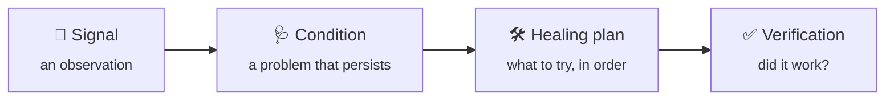
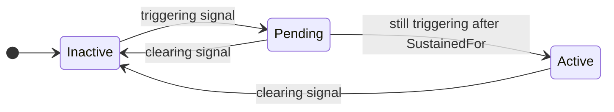
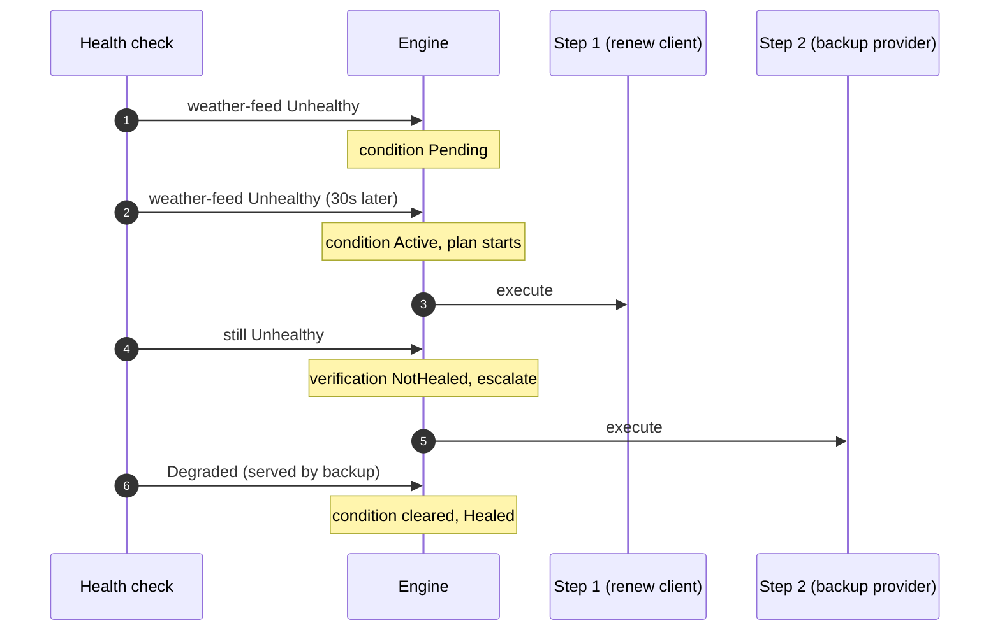

# Concepts

Homeostat is built on four ideas. Once they click, the whole API reads naturally.

The name comes from *homeostasis*: the ability of a living system to bring itself back to a stable
state after a disturbance.

## 1. Signal: "here is what I see"

A **signal** is a single observation about one part of your application:

| Field | Example |
|---|---|
| `Source` | `"weather-feed"` |
| `Severity` | `Healthy`, `Degraded` or `Unhealthy` |
| `Timestamp` | when it was observed |
| `Message`, `Tags` | optional details |

Signals say nothing about what to do. They come from health checks, from built-in detectors (thread
pool, memory, exceptions, HTTP clients, circuit breakers) and from your own code.
→ [Signals](signals.md) · [Detectors](detectors.md)

## 2. Condition: "this is a real problem"

A single bad signal is often noise: a timeout, a slow response, a restart. A **condition** turns a
stream of signals into a decision, and it has a lifecycle:

Only an **active** condition starts its healing plan. → [Conditions](conditions.md)

## 3. Healing plan: "try this, then that"

A **healing plan** is an ordered list of actions. Homeostat runs the first one; it moves to the next
only if it has evidence that the previous one did not work, or the action itself failed (threw or
timed out). Earlier steps should be cheaper and less
invasive, later steps stronger. → [Healing plans](healing-plans.md)

## 4. Verification: "did it actually work?"

After each action, Homeostat checks the outcome instead of assuming success:

| Outcome | Meaning | What happens next |
|---|---|---|
| ✅ `Healed` | The condition cleared | The run stops successfully |
| ❌ `NotHealed` | Fresh signals still show the problem | Escalate to the next step |
| ❔ `Inconclusive` | No evidence either way | Stop, log, let a human decide |

A stopped run is not final: if the condition is still active when the cooldown ends, the next
triggering signal starts a new run from step 1.

The third outcome is deliberate: **Homeostat never escalates blindly.** If it cannot tell whether a
step worked, running a stronger one could make things worse.

## Around the loop: guardrails

Everything above runs inside safety limits: dry-run by default, a global action budget, cooldowns,
timeouts, a concurrency limit and a kill switch. → [Guardrails](guardrails.md)

Three more tools keep a self-healing system calm and accountable:

- **Hysteresis**: `ClearAfter` requires recovery to last before a condition clears, so it does not flap.
  → [Conditions](conditions.md#how-long-recovery-must-last-clearafter-hysteresis)
- **Causes and symptoms**: `SuppressedBy` stops Homeostat from healing the effects of a failure while its
  cause is active. → [Conditions](conditions.md#causes-and-symptoms-suppressedby)
- **Human in the loop**: `RequireApproval` makes a risky step wait for a person.
  → [Healing plans](healing-plans.md#human-in-the-loop-requireapproval)

## A full run, step by step

## Vocabulary

| Term | Meaning |
|---|---|
| **Source** | Logical name of an observed component, usually a health check name |
| **Trigger** | Rule that says a signal indicates the problem |
| **Clear rule** | Rule that says a signal indicates the problem is gone |
| **Run** | One execution of a healing plan, from the first step to its outcome |
| **Step** | One action within a plan |
| **Escalation** | Moving to the next step after a `NotHealed` outcome or a failed action |
| **Hysteresis** | Requiring recovery to last (`ClearAfter`) before a condition clears |
| **Suppression** | Not healing a symptom while its cause (`SuppressedBy`) is active |
| **Approval** | A person's yes or no on a step marked with `RequireApproval` |
| **Switch** | A named on/off flag that plans turn on and your code reads |
