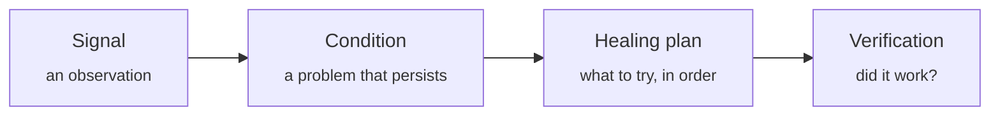
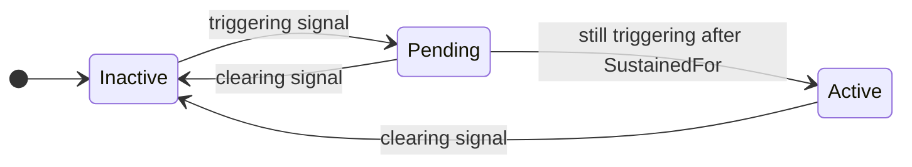
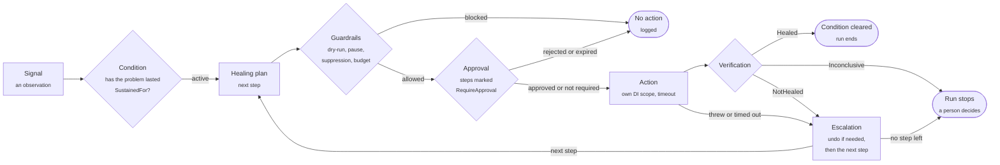
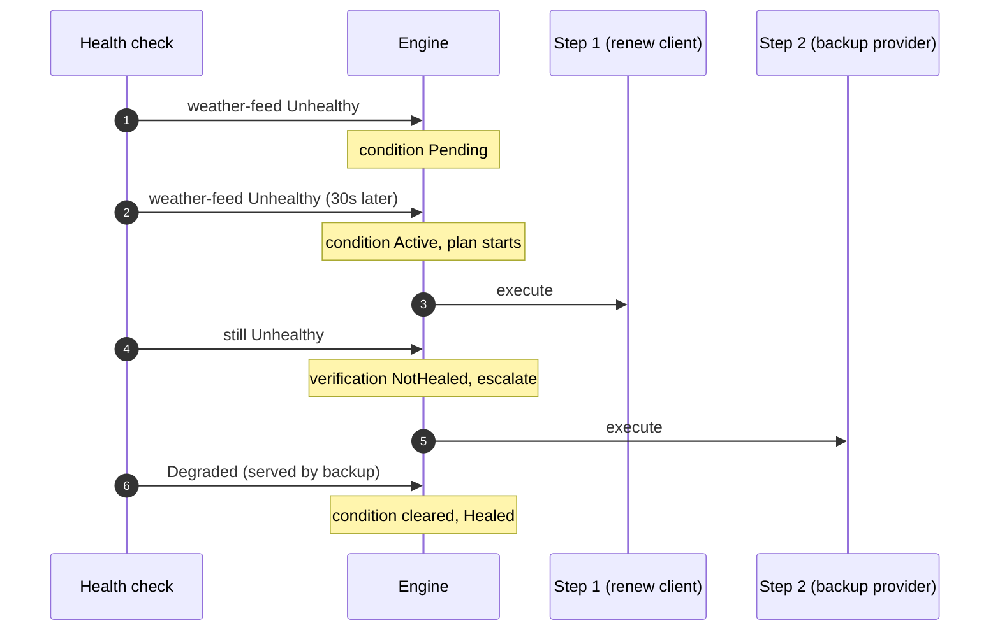

# Concepts

The model behind Homeostat and the vocabulary the rest of the documentation uses. Read it after
[Getting started](getting-started.md) and before the reference pages.

Homeostat is built on four ideas: signals, conditions, healing plans and verification.

The name comes from *homeostasis*: the ability of a living system to bring itself back to a stable
state after a disturbance.

## 1. Signal: "here is what I see"

A **signal** is a single observation about one part of your application:

| Field | Example |
|---|---|
| `Source` | `"weather-feed"` |
| `Severity` | `Healthy`, `Degraded` or `Unhealthy` |
| `Timestamp` | when it was observed |
| `Value` | optional measurement, such as a latency in milliseconds or a queue length |
| `Message`, `Tags` | optional details |

Signals say nothing about what to do. They come from health checks, from built-in detectors (thread
pool, memory, exceptions, HTTP clients, circuit breakers), from alerts of monitoring tools and from your own code.
→ [Signals](signals.md) · [Detectors](detectors.md)

## 2. Condition: "this is a real problem"

A single bad signal is often noise: a timeout, a slow response, a restart. A **condition** turns a
stream of signals into a decision, and it has a lifecycle:

With `SustainedFor` at zero (the default), the first triggering signal makes the condition active at once. Only an
**active** condition starts its healing plan. → [Conditions](conditions.md)

## 3. Healing plan: "try this, then that"

A **healing plan** is an ordered list of steps, each running one action. Homeostat runs the first step; it moves to
the next only if it has evidence that the previous one did not work, or the action itself failed (threw or timed
out). Put the cheaper, less invasive steps first and the stronger ones later. → [Healing plans](healing-plans.md)

## 4. Verification: "did it actually work?"

After each action, a verifier checks the outcome instead of assuming success. The default verifier,
`ConditionClearedVerifier`, watches the condition until the verification timeout (1 minute by default):

| Outcome | Meaning (default verifier) | What happens next |
|---|---|---|
| `Healed` | The condition is no longer active: it cleared (a new episode may already be pending) | The run stops successfully |
| `NotHealed` | The condition is still active, and a signal arrived after the action | Escalate to the next step |
| `Inconclusive` | The condition is still active, and no signal arrived after the action | Stop, log, let a person decide |

A stopped run is not final: if the condition is still active when the cooldown ends, the next
triggering signal starts a new run from step 1. The exception is a step a person rejected: the plan then waits until
the condition clears (or until someone releases the hold).

The third outcome is deliberate: **Homeostat never escalates blindly.** If it cannot tell whether a
step worked, running a stronger one could make things worse.

## Around the loop: guardrails

Everything above runs inside safety limits: dry-run by default, a global action budget, cooldowns,
timeouts, a concurrency limit and a kill switch. → [Guardrails](guardrails.md)

Three more tools keep a self-healing system stable and accountable:

- **Hysteresis**: `ClearAfter` requires recovery to last before a condition clears, so it does not flap.
  → [Conditions](conditions.md#how-long-recovery-must-last-clearafter-hysteresis)
- **Causes and symptoms**: `SuppressedBy` stops Homeostat from healing the effects of a failure while its
  cause is active. → [Conditions](conditions.md#causes-and-symptoms-suppressedby)
- **Human in the loop**: `RequireApproval` makes a risky step wait for a person.
  → [Healing plans](healing-plans.md#human-in-the-loop-requireapproval)

## The whole loop

The diagram puts the pieces together. Cooldown, concurrency and the cluster lease are checked once, when a run
starts. The other guardrails and approval are checked before each step: a paused or suppressed
plan, a spent budget or a rejected approval stops the run without acting, and in dry-run Homeostat logs every step it
would run, then stops. A compensating action (`UndoWith`) runs before escalating when the step was verified as
`NotHealed` or its action timed out, not when the action threw. When no step is left, the run ends as `NotHealed`.

## A full run, step by step

## Where the knowledge of your architecture goes

Self-healing needs knowledge of the architecture: which components exist, how each one fails, what depends on what,
and what can safely be done about it. Homeostat does not discover that knowledge, and does not assume an architecture.
It splits the work in two:

- **The loop is general.** Observe, decide that a problem is real, choose the next step, act within the guardrails,
  verify, record. It is the same for a web API, a worker, a message consumer or a modular monolith, and it is what the
  library provides (the monitor, analyze, plan and execute stages of the MAPE-K loop of autonomic computing).
- **The knowledge is yours.** You state it in code or [configuration](configuration.md), where it is versioned,
  reviewed and tested like the rest of the application.

| Knowledge of the architecture | Where you state it |
|---|---|
| Which components exist and how they are observed | Signal sources: health checks, metrics, probes, the [integration packages](integrations.md) (`ForSource("weather-feed")`) |
| What counts as a failure of each component, and for how long | [Conditions](conditions.md): thresholds, `SustainedFor`, `ClearAfter`, trends, anomalies |
| What depends on what (heal the cause, not its symptoms) | `SuppressedBy` and composite conditions: the dependency graph, as you know it |
| What can be done about each component, from the least to the most invasive | [Actions](actions.md) and the order of the steps of a [healing plan](healing-plans.md) |
| How the application is deployed | Plan scope (per instance or `OncePerCluster()`), the shared [store](persistence-and-clusters.md) |
| Which degraded modes are acceptable | [Switches](actions.md), read by your code, feature flags or Polly |
| How risky each action is | Approvals, compensating actions (`UndoWith`), restart limits and the other [guardrails](guardrails.md) |

Because the knowledge is written down, it can be checked. The [dry-run](guardrails.md) shows what a plan would do, a
[replay](intelligence.md) runs recorded signals against a new configuration, the [coverage report](intelligence.md)
shows which conditions and steps were never exercised, and [scenario tests](testing.md) run a plan on simulated time.
When the architecture changes, the conditions and plans change with it, in the same pull request.
[From architecture to configuration](architecture-examples.md) works through two systems, fact by fact.

The limit of this design is its point of view: Homeostat runs inside one application. It coordinates the instances of
that application through the shared store, and sees other services only through the signals it receives (their health
checks, its HTTP and gRPC clients, alerts from your monitoring). Decisions that need a view of the whole system, such
as rebalancing a cluster or moving traffic between regions, stay with the platform and the orchestrator; Homeostat can
take part through its [Kubernetes and Azure actions](cloud.md) and through switches, but does not replace that level.

## Vocabulary

| Term | Meaning |
|---|---|
| **Source** | Logical name of an observed component, usually a health check name |
| **Trigger** | Rule that says a signal indicates the problem |
| **Clear rule** | Rule that says a signal indicates the problem is gone |
| **Run** | One execution of a healing plan, from the first step to its outcome |
| **Step** | One action within a plan |
| **Escalation** | Moving to the next step after a `NotHealed` outcome or a failed action |
| **Verifier** | What judges a step: `ConditionClearedVerifier` by default, or your own with `UseVerifier<T>()` |
| **Guardrail** | A limit around the loop: dry-run, budget, cooldown, concurrency, timeouts, kill switch |
| **Hysteresis** | Requiring recovery to last (`ClearAfter`) before a condition clears |
| **Suppression** | Not healing a symptom while its cause (`SuppressedBy`) is active |
| **Approval** | A person's yes or no on a step marked with `RequireApproval` |
| **Switch** | A named on/off flag that plans turn on and your code reads |
| **Store** | Where plan state, budget, history and the shared control state live (in memory by default) |

See also: [Healing plans](healing-plans.md) · [Guardrails](guardrails.md) · [Design notes](design.md)
