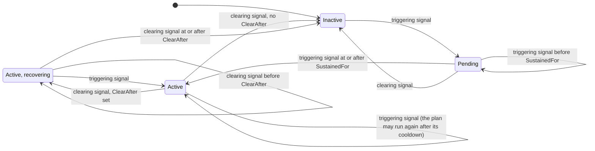

# Conditions

A condition decides when a stream of signals means a real problem. This page covers the rules a condition can use,
its lifecycle and how it is validated. Each condition has a unique name and, usually, a healing plan.

```csharp
.AddCondition("weather-feed-down", c => c
    .ForSource("weather-feed")
    .WhenSeverityAtLeast(SignalSeverity.Unhealthy)
    .SustainedFor(TimeSpan.FromSeconds(30))
    .Heal(p => p.With<RenewFeedClientAction>()))
```

## The questions a condition answers

| Question | Builder method | Default |
|---|---|---|
| Which signals do I look at? | `ForSource(...)`, `Where(...)` | All signals |
| When is it a problem? | `WhenSeverityAtLeast(...)`, `When(...)` | Severity `Unhealthy` |
| When is it over? | `ClearWhen(...)` | Any relevant signal that does not trigger |
| How long must it last? | `SustainedFor(...)` | Immediately |
| How long must recovery last? | `ClearAfter(...)` | Immediately |
| Is it only a symptom of another problem? | `SuppressedBy(...)` | No |
| Does it depend on a value, a trend or an anomaly? | `WhenValueAbove(...)`, `WhenRisingFasterThan(...)`, `WhenAnomalouslyHigh(...)` | No |
| Must it happen several times? | `Occurrences(...)` | No |
| Is it a combination of other conditions? | `WhenAllActive(...)`, `WhenAnyActive(...)` | No |

### Which signals: `ForSource` and `Where`

```csharp
c.ForSource("weather-feed")                                   // by source name
c.Where(s => s.Tags?.ContainsKey("region") == true)           // by any property
c.ForSource("weather-feed").Where(s => s.Message != null)     // both must match
```

`ForSource` compares the source exactly (ordinal, case-sensitive). Signals that do not match are ignored: they
neither trigger nor clear the condition.

### When it is a problem: `WhenSeverityAtLeast` and `When`

```csharp
c.WhenSeverityAtLeast(SignalSeverity.Degraded)                  // Degraded or Unhealthy
c.When(s => s.Severity == SignalSeverity.Unhealthy && s.Message?.Contains("timeout") == true)
```

### When it is over: `ClearWhen`

By default, a relevant signal that does not trigger the condition clears it. With the default threshold
(`Unhealthy`), a `Degraded` signal therefore clears it: the component is not fully healthy, but it is no longer down.
Override this when you need something stricter:

```csharp
c.ClearWhen(s => s.Severity == SignalSeverity.Healthy)   // only full recovery clears it
```

With a custom `ClearWhen`, a relevant signal that neither triggers nor clears leaves the state unchanged, and a
`Pending` window keeps running. A condition has one trigger rule: calling `When`, `WhenSeverityAtLeast` or another
`When...` method again replaces the previous rule, and calling `Where` again replaces the previous filter.

> [!IMPORTANT]
> A condition must call `ForSource(...)` or define `ClearWhen(...)`. Otherwise a healthy signal from any component
> would clear it, so Homeostat refuses the configuration with an `InvalidOperationException` at startup.

### How long: `SustainedFor`

`SustainedFor` filters out blips. The condition becomes active only when triggering signals persist for the given
duration.

| Second | Signal | Status |
|---|---|---|
| 0 | Unhealthy | `Pending` (window starts) |
| 10 | Healthy | `Inactive` (a blip) |
| 20 | Unhealthy | `Pending` (window restarts here) |
| 40 | Unhealthy | `Pending` (only 20 s so far) |
| 50 | Unhealthy | `Active`: the plan starts |

Activation is evaluated when a signal arrives: the condition activates on the first triggering signal at or after
`SustainedFor`. A slow signal period therefore delays activation, so keep the period shorter than `SustainedFor`.
With health checks every 30 seconds and `SustainedFor(30s)`, the condition activates on the second unhealthy check at
the earliest; with checks every 60 seconds, after a full minute.

A source that goes quiet does not keep the window open: when two triggering signals are more than twice
`SustainedFor` apart (at least five minutes), the window starts again at the later one, so two isolated blips an hour
apart never activate the condition.

### How long recovery must last: `ClearAfter` (hysteresis)

A component that is recovering often alternates between good and bad answers. Without hysteresis the condition
flaps: it clears on the first good signal, activates again on the next bad one, and every activation is a new chance
to run the plan. `ClearAfter` makes an active condition clear only when clearing signals persist for the given
duration:

```csharp
c.ForSource("weather-feed")
 .ClearAfter(TimeSpan.FromMinutes(2))      // 2 minutes of health to clear
```

| Second | Signal | Status |
|---|---|---|
| 0 | Unhealthy | `Active` |
| 30 | Healthy | `Active`, recovery starts (`ClearingSince` = 30) |
| 60 | Unhealthy | `Active`, recovery restarts from zero |
| 90 | Healthy | `Active`, recovery starts again |
| 210 | Healthy | `Inactive`: 2 minutes of health |

How it behaves:

- Like `SustainedFor`, it is evaluated when signals arrive and uses their timestamps.
- It applies only to an active condition. A `Pending` condition still goes back to `Inactive` at the first clearing
  signal.
- The default verifier waits for the condition to clear. If recovery is in progress (`ClearingSince` is set) when
  `VerificationTimeout` expires, it keeps waiting for up to `ClearAfter` more, so a fix that works is not reported as
  `NotHealed`. Keep `VerificationTimeout` longer than `ClearAfter` plus one signal period.
- The snapshot exposes `ClearingSince` while the condition waits.
- Clearing needs signals. A source that goes quiet when healthy (an HTTP client without traffic, for example) keeps
  the condition active until a clearing signal arrives after `ClearAfter`. Prefer sources that report regularly, such
  as health checks.

For hysteresis on thresholds (enter at one level, leave at another), combine the trigger and clear rules:
`WhenSeverityAtLeast(SignalSeverity.Unhealthy)` with `ClearWhen(s => s.Severity == SignalSeverity.Healthy)` activates
on `Unhealthy` and clears only on full health, ignoring `Degraded` in between.

### Causes and symptoms: `SuppressedBy`

When a shared dependency fails, several conditions activate at once: the network is down, so the forecast client
fails, the air quality client fails and the cache misses. Healing every symptom wastes the action budget and can make
things worse. Declare the cause:

```csharp
.AddCondition("network-down", c => c
    .ForSource("network")
    .Heal(p => p.With<ResetNetworkClientAction>()))
.AddCondition("forecast-failing", c => c
    .ForSource("http:forecast")
    .SuppressedBy("network-down")
    .Heal(p => p.With<RenewForecastClientAction>()))
```

While `network-down` is pending or active:

- `forecast-failing` is still tracked, logged and reported, with `SuppressedBy = "network-down"` in
  `IHomeostatControl.GetConditions()` and in the status endpoint;
- its plan does not start, and a run already in progress stops before its next step with outcome `Suppressed`.

A pending cause counts too, so a symptom whose `SustainedFor` is shorter than its cause's does not act in the
meantime. A pending cause that receives no triggering signal for its `SustainedFor`, or for one minute if that is
longer, no longer suppresses: its source stopped reporting, and it would otherwise hold its symptoms back forever.

When `network-down` clears, the next triggering signal of `forecast-failing` starts its plan as usual (after the
cooldown, if a run happened before). A condition can list several causes. Unknown names, a condition that suppresses
itself and cycles (`a` suppressed by `b`, `b` by `a`) fail at startup.

### Values, trends and anomalies

Many signals carry a measured `Value` besides their severity: the detectors fill it (thread pool latency in ms,
memory load from 0 to 1, exceptions per second, HTTP failure ratio) and so do [metric signals](detectors.md#metrics).
Conditions can use it directly:

```csharp
c.ForSource("memory").WhenValueAbove(0.9)                                      // a fixed threshold
c.ForSource("memory").WhenRisingFasterThan(0.01, TimeSpan.FromMinutes(30))    // +1% per minute: a slow leak
c.ForSource("http:forecast").WhenAnomalouslyHigh(3, TimeSpan.FromHours(1))    // 3σ above the last hour
```

| Rule | Triggers when | Good for |
|---|---|---|
| `WhenValueAbove(x)`, `WhenValueBelow(x)` | The value is at or above (at or below) the threshold | Limits you know |
| `WhenRisingFasterThan(perMinute, window)`, `WhenFallingFasterThan(...)` | The least-squares slope over the window exceeds the rate (at least 5 values by default, spanning at least half the window) | Leaks, growing backlogs, draining pools: act before the limit |
| `WhenAnomalouslyHigh(z, window)`, `WhenAnomalouslyLow(...)` | The value is `z` standard deviations from the mean of the window (at least 30 earlier values by default) | Metrics without a natural threshold that change slowly |
| `WhenSeasonallyHigh(z, seasonality)`, `WhenSeasonallyLow(...)` | The value is `z` standard deviations from the values of the same time of day or week in earlier periods | Metrics with a daily or weekly rhythm: [below](#seasonal-anomalies-whenseasonallyhigh-and-whenseasonallylow) |

Things to know:

- Signals without a value never trigger these rules. Unless you set `ClearWhen`, they do not clear them either: value,
  trend, anomaly, seasonal and projection rules clear only on a signal they can evaluate and find good. A signal
  without a value (a failed probe, for example), or too little history for the rule, leaves the condition as it is.
- An anomaly that lasts becomes the new baseline, so the condition eventually clears even if the value stays high.
  Combine it with a fixed threshold when a high level must keep the condition active.
- A window keeps about 8,192 points, whatever the signal rate: a source that publishes more often than every
  window / 8,192 (about 37 ms for a 5-minute window) keeps the latest value of each such interval, so memory stays
  bounded (about 128 KB per condition). Signals with timestamps older than the latest point (a source that lags
  behind another) are kept as given; beyond 8,704 points the earliest received are dropped, whatever the order. See [Performance](performance.md#memory).
- The history of trend, anomaly and projection rules lives in memory and starts empty after a restart, or when the
  condition's own configuration changes (for conditions defined in [configuration](configuration.md)). Seasonal
  baselines are kept in the store instead (below).
- The anomaly rule floors the standard deviation at 1% of the mean, so a perfectly flat history does not turn every
  tiny change into an anomaly; with an all-zero history, any non-zero value is anomalous.

### Seasonal anomalies: `WhenSeasonallyHigh` and `WhenSeasonallyLow`

Traffic, queue depth and latency often follow the clock: busy at 10:00 on weekdays, quiet at night and on Sundays. A
fixed threshold fires every morning or misses a problem at night, and an anomaly against the last hour fires at every
ramp-up. A seasonal rule compares each value with the same time slot of earlier days or weeks:

```csharp
c.ForSource("requests-per-second")
 .WhenSeasonallyLow(4, Seasonality.Daily())                       // traffic collapses for the time of day

c.ForSource("ingest-queue-depth")
 .WhenSeasonallyHigh(4, Seasonality.Weekly(
     bucket: TimeSpan.FromHours(1),
     timeZone: TimeZoneInfo.FindSystemTimeZoneById("Europe/Rome")))   // Monday 10:00 vs earlier Mondays 10:00
```

- `Seasonality.Daily()` uses 15-minute slots and `Seasonality.Weekly()` 1-hour slots, in UTC unless you pass the time
  zone the load follows (daylight saving time included).
- A slot can trigger once it has learned `minimumPeriods` periods (3 by default): three days for a daily cycle, three
  weeks for a weekly one. Until then the rule neither triggers nor clears.
- The baseline weighs recent periods more (each new period counts 25% once there are a few), so a lasting change of
  level, such as a new client, becomes the new normal within a week or so of periods. An incident that lasts hours
  enters the baseline with the same weight: keep the threshold strict (4 or more) for noisy metrics.
- The deviation is floored at 1% of the slot's mean, as for the anomaly rule.
- The baseline is kept in the store ([documents](persistence-and-clusters.md#what-is-stored)) every 5 minutes and when
  the application stops, and loaded before the engine processes signals, so a deployment does not reset weeks of
  learning. A configuration change that keeps the cycle keeps the baseline too. Loading happens in the background:
  the application starts at once, and the engine waits for the baselines (signals queue meanwhile) at most 10 seconds,
  then starts learning over. Each store call is bounded (10 seconds), one at a time per baseline, and the application's
  shutdown waits for the store at most 10 seconds for the loop and 10 more for the final save, and never past the
  host's shutdown timeout (`HostOptions.ShutdownTimeout`).
- With a shared store, a starting instance loads the baseline saved by the others, then learns from its own signals
  and saves its own version every 5 minutes (the last to save wins). This suits instances behind a load balancer,
  which see the same rhythm; for instances with different rhythms, give them separate stores or key prefixes.
- One seasonal rule per condition: another trigger rule on the same condition is refused.
- Time zones are matched by id: use IANA ids (`Europe/Rome`) on every host, so a baseline saved on one is found on
  the others. Slots are whole minutes, at most 2016 per period (5 minutes for a weekly cycle).
- From configuration: `"SeasonallyHigh": { "ZScore": 4, "Seasonality": "Weekly", "Bucket": "1h", "TimeZone": "Europe/Rome" }`.

### Predictions: `WhenProjectedAbove` and `WhenProjectedBelow`

These rules trigger when the trend of the values will cross a threshold within a horizon, before the problem happens:

```csharp
c.ForSource("disk-used").WhenProjectedAbove(0.95, within: TimeSpan.FromHours(2), window: TimeSpan.FromHours(2))
```

See [Learning and foresight](intelligence.md#predictive-conditions).

### Intermittent problems: `Occurrences`

A dependency that fails one call in three never produces a sustained run of failures. `Occurrences` counts the
matches of the trigger rule within a window, not necessarily in a row:

```csharp
c.ForSource("identity-provider")                           // any trigger rule works
 .WhenSeverityAtLeast(SignalSeverity.Degraded)
 .Occurrences(5, TimeSpan.FromMinutes(10))                  // 5 bad checks in 10 minutes
```

The condition activates on the match that reaches the count and, unless you set `ClearWhen`, clears when the
matches within the window drop below the count: a few good signals in between do not end it. Only the latest `count`
matches are kept (they alone decide), so memory does not grow with the signal rate.

### Combinations: `WhenAllActive` and `WhenAnyActive`

A composite condition is active while all (or any) of the listed conditions are active. It has no source of its
own and can have its own plan, which is useful when a combination needs a different fix than its parts:

```csharp
.AddCondition("db-slow", c => c.ForSource("db"))
.AddCondition("cache-down", c => c.ForSource("cache"))
.AddCondition("platform-degraded", c => c
    .WhenAllActive("db-slow", "cache-down")
    .SustainedFor(TimeSpan.FromMinutes(1))
    .Heal(p => p.TurnOnSwitch("read-only-mode")))   // turned off when the condition clears
```

Composites are evaluated after every signal, after the conditions they depend on. They support `SustainedFor`,
`ClearAfter`, `SuppressedBy` and plans like any condition, and may depend on other composites. `ForSource`, `Where`,
the `When...` rules, `ClearWhen` and `Occurrences` do not apply to a composite and throw `InvalidOperationException`.
Unknown names, self-references and cycles fail at startup.

## Lifecycle



"Active, recovering" is not a separate status: the condition reports `Active`, with `ClearingSince` set. Without
`SustainedFor`, the first triggering signal moves the condition from `Inactive` to `Active` at once.

While a condition stays active, every new triggering signal gives its plan another chance to run, once the
[cooldown](guardrails.md#cooldown) has elapsed. A problem that is not fixed is retried at a controlled pace, within the
global action budget.

## Conditions without a plan

A condition without `Heal(...)` is tracked and logged but never acts. Use it to observe a problem before deciding how
to fix it:

```csharp
.AddCondition("air-quality-slow", c => c
    .ForSource("air-quality")
    .WhenSeverityAtLeast(SignalSeverity.Degraded)
    .SustainedFor(TimeSpan.FromMinutes(2)))
```

## Several conditions on the same source

Different conditions can watch the same source with different rules. For example, a mild reaction to `Degraded` and a
stronger one to `Unhealthy`:

```csharp
.AddCondition("feed-slow", c => c
    .ForSource("weather-feed")
    .When(s => s.Severity == SignalSeverity.Degraded)
    .SustainedFor(TimeSpan.FromMinutes(5))
    .Heal(p => p.With<RenewFeedClientAction>()))
.AddCondition("feed-down", c => c
    .ForSource("weather-feed")
    .WhenSeverityAtLeast(SignalSeverity.Unhealthy)
    .SustainedFor(TimeSpan.FromSeconds(30))
    .Heal(p => p.With<SwitchToBackupProviderAction>()))
```

With the default clear rule, an `Unhealthy` signal clears `feed-slow` (it does not trigger it), so the two conditions
hand over to each other. Only one run executes at a time by default (`MaxConcurrentHealings = 1`).

## Rules and validation

- Condition names must be unique; duplicates fail at startup.
- `SustainedFor` and `ClearAfter` cannot be negative or longer than about 49 days (the .NET timer limit).
- `SuppressedBy`, `WhenAllActive` and `WhenAnyActive` must name registered conditions, without self-references
  or cycles.
- A plan must contain at least one action.
- `ActionTimeout`, `VerificationTimeout`, `RequireApproval` and `UndoWith` apply to the previous step: called before
  any step, they throw `InvalidOperationException`.
- `ActionTimeout` and `VerificationTimeout` must be positive and at most about 49 days, and `Cooldown` cannot be
  negative or longer than about 49 days; invalid values throw `ArgumentOutOfRangeException` when the plan is
  configured.
- Trigger and clear predicates should be fast and must not throw. If one throws, the error is logged and that signal
  is skipped for that condition.

See also: [Signals](signals.md), [Detectors](detectors.md), [Healing plans](healing-plans.md),
[Guardrails](guardrails.md).
