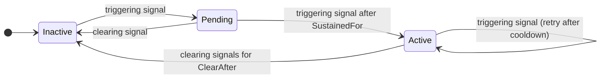

# Conditions

A condition decides **when a stream of signals means a real problem**. Each condition has a unique
name and, usually, a healing plan.

```csharp
.AddCondition("weather-feed-down", c => c
    .ForSource("weather-feed")
    .WhenSeverityAtLeast(SignalSeverity.Unhealthy)
    .SustainedFor(TimeSpan.FromSeconds(30))
    .Heal(p => p.With<RenewFeedClientAction>()))
```

## The questions a condition answers

| Question | Builder method | Default |
|---|---|---|
| Which signals do I look at? | `ForSource(...)`, `Where(...)` | All signals |
| When is it a problem? | `WhenSeverityAtLeast(...)`, `When(...)` | Severity `Unhealthy` |
| When is it over? | `ClearWhen(...)` | Any relevant signal that does not trigger |
| How long must it last? | `SustainedFor(...)` | Immediately |
| How long must recovery last? | `ClearAfter(...)` | Immediately |
| Is it only a symptom of another problem? | `SuppressedBy(...)` | No |

### Which signals: `ForSource` and `Where`

```csharp
c.ForSource("weather-feed")                                   // by source name
c.Where(s => s.Tags?.ContainsKey("region") == true)           // by any property
c.ForSource("weather-feed").Where(s => s.Message != null)     // both must match
```

Signals that do not match are completely ignored: they neither trigger nor clear the condition.

### When it is a problem: `WhenSeverityAtLeast` and `When`

```csharp
c.WhenSeverityAtLeast(SignalSeverity.Degraded)                  // Degraded or Unhealthy
c.When(s => s.Severity == SignalSeverity.Unhealthy && s.Message?.Contains("timeout") == true)
```

### When it is over: `ClearWhen`

By default, a relevant signal that does **not** trigger clears the condition. With the default
threshold (`Unhealthy`), a `Degraded` signal therefore clears it: the component is not fully healthy,
but it is no longer down. Override this when you need something stricter:

```csharp
c.ClearWhen(s => s.Severity == SignalSeverity.Healthy)   // only full recovery clears it
```

With a custom `ClearWhen`, a relevant signal that neither triggers nor clears leaves the state
unchanged, and a `Pending` window keeps running. Calling `When`, `WhenSeverityAtLeast` or `Where` again
replaces the previous rule.

> **Safety rule:** a condition must call `ForSource(...)` or define `ClearWhen(...)`. Otherwise a
> healthy signal from *any* component would clear it, so Homeostat refuses the configuration with an
> exception at startup.

### How long: `SustainedFor`

`SustainedFor` filters out blips. The condition becomes active only when triggering signals persist
for the given duration.

| Second | Signal | Status |
|---|---|---|
| 0 | Unhealthy | `Pending` (window starts) |
| 10 | Healthy | `Inactive` (just a blip) |
| 20 | Unhealthy | `Pending` (window restarts here) |
| 40 | Unhealthy | `Pending` (only 20 s so far) |
| 50 | Unhealthy | **`Active`**: the plan starts |

Activation is evaluated when a signal arrives: the condition activates on the first triggering signal
at or after `SustainedFor`. A slow signal period therefore **delays** activation, so keep it shorter than
`SustainedFor`. With health checks every 30 seconds and `SustainedFor(30s)`, the condition activates on
the second unhealthy check at the earliest; with checks every 60 seconds, after a full minute.

### How long recovery must last: `ClearAfter` (hysteresis)

A component that is recovering often alternates between good and bad answers. Without hysteresis the
condition flaps: it clears on the first good signal, activates again on the next bad one, and every
activation is a new chance to run the plan. `ClearAfter` makes an active condition clear only when clearing
signals persist for the given duration:

```csharp
c.ForSource("weather-feed")
 .ClearAfter(TimeSpan.FromMinutes(2))      // 2 minutes of health to clear
```

| Second | Signal | Status |
|---|---|---|
| 0 | Unhealthy | **`Active`** |
| 30 | Healthy | `Active`, recovery starts (`ClearingSince` = 30) |
| 60 | Unhealthy | `Active`, recovery restarts from zero |
| 90 | Healthy | `Active`, recovery starts again |
| 210 | Healthy | **`Inactive`**: 2 minutes of health |

Rules:

- Like `SustainedFor`, it is evaluated when signals arrive and uses their timestamps.
- It only applies to an **active** condition; a `Pending` condition still resets at the first clearing signal.
- The default verifier waits for the condition to clear. If recovery is in progress (`ClearingSince` is set)
  when `VerificationTimeout` expires, it keeps waiting for up to `ClearAfter` more, so a fix that works is
  not reported as `NotHealed`.
- The snapshot exposes `ClearingSince` while the condition waits.
- Clearing needs signals: a source that goes quiet when healthy (an HTTP client without traffic, for example)
  keeps the condition active until a clearing signal arrives after `ClearAfter`. Prefer sources that report
  regularly, such as health checks.

For hysteresis on **thresholds** (enter at one level, leave at another), combine the trigger and clear rules:
`WhenSeverityAtLeast(SignalSeverity.Unhealthy)` with `ClearWhen(s => s.Severity == SignalSeverity.Healthy)`
activates on `Unhealthy` and clears only on full health, ignoring `Degraded` in between.

### Causes and symptoms: `SuppressedBy`

When a shared dependency fails, several conditions activate at once: the network is down, so the forecast
client fails, the air quality client fails and the cache misses. Healing every symptom wastes the action
budget and can make things worse. Declare the cause:

```csharp
.AddCondition("network-down", c => c
    .ForSource("network")
    .Heal(p => p.With<ResetNetworkClientAction>()))
.AddCondition("forecast-failing", c => c
    .ForSource("http:forecast")
    .SuppressedBy("network-down")
    .Heal(p => p.With<RenewForecastClientAction>()))
```

While `network-down` is **pending or active**:

- `forecast-failing` is still tracked, logged and reported, with `SuppressedBy = "network-down"` in
  `IHomeostatControl.GetConditions()` and in the status endpoint;
- its plan does not start, and a run already in progress stops before its next step with outcome `Suppressed`.

A pending cause counts too, so a symptom whose `SustainedFor` is shorter than its cause's does not act in the
meantime. When `network-down` clears, the next triggering signal of `forecast-failing` starts its plan as usual (after
the cooldown, if a run happened before). A condition can list several causes. Unknown names, a condition that
suppresses itself and cycles (`a` suppressed by `b`, `b` by `a`) fail at startup.

## Lifecycle



While a condition stays **active**, every new triggering signal gives its plan another chance to run,
once the [cooldown](guardrails.md#cooldown) has elapsed. A problem that is not fixed is retried at a
controlled pace, within the global action budget.

## Conditions without a plan

A condition without `Heal(...)` is tracked and logged but never acts. This is useful to observe a
problem before deciding how to fix it:

```csharp
.AddCondition("air-quality-slow", c => c
    .ForSource("air-quality")
    .WhenSeverityAtLeast(SignalSeverity.Degraded)
    .SustainedFor(TimeSpan.FromMinutes(2)))
```

## Several conditions on the same source

Different conditions can watch the same source with different rules. For example, a mild reaction to
`Degraded` and a stronger one to `Unhealthy`:

```csharp
.AddCondition("feed-slow", c => c
    .ForSource("weather-feed")
    .When(s => s.Severity == SignalSeverity.Degraded)
    .SustainedFor(TimeSpan.FromMinutes(5))
    .Heal(p => p.With<RenewFeedClientAction>()))
.AddCondition("feed-down", c => c
    .ForSource("weather-feed")
    .WhenSeverityAtLeast(SignalSeverity.Unhealthy)
    .SustainedFor(TimeSpan.FromSeconds(30))
    .Heal(p => p.With<SwitchToBackupProviderAction>()))
```

With the default clear rule, an `Unhealthy` signal clears `feed-slow` (it does not trigger it), so the two
conditions hand over to each other. Remember that only one run executes at a time by default
(`MaxConcurrentHealings = 1`).

## Rules and validation

- Condition names must be unique; duplicates fail at startup.
- `SustainedFor` and `ClearAfter` cannot be negative.
- `SuppressedBy` must name registered conditions, without self-references or cycles.
- A plan must contain at least one action.
- `ActionTimeout` and `VerificationTimeout` must be positive (at most about 49 days, the .NET timer
  limit) and `Cooldown` cannot be negative; invalid
  values throw `ArgumentOutOfRangeException` when the plan is configured.
- Trigger and clear predicates should be fast and must not throw. If one throws, the error is logged
  and that signal is skipped for that condition.
