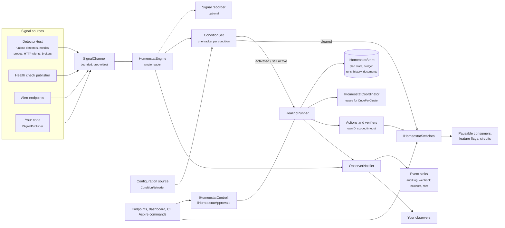

# Design notes

How Homeostat is put together: the components, how a signal becomes a healing run, where state lives, and the rules
the code follows. Read it before extending Homeostat (a store, a coordinator, a sink) or contributing to it.

## Architecture



| Component | Role |
|---|---|
| `DetectorHost` | A `BackgroundService` that calls every `ISignalDetector` at `DetectionInterval`, on `TimeProvider`. Runtime detectors, metric and event counter signals, HTTP client signals and probes are detectors. Probes start their calls and return at once, so a slow dependency never delays the loop |
| `SignalChannel` | The in-memory buffer behind `ISignalPublisher`: bounded (`SignalBufferCapacity`), drops the oldest signal when full, never blocks the publisher |
| `HomeostatEngine` | A `BackgroundService`, the only reader of the channel. It records the signal (when `AddSignalRecording` is on), feeds every relevant condition tracker, and hands activations to the runner |
| `ConditionSet` | One `ConditionTracker` per condition, validated as a whole; composite conditions are evaluated after the conditions they depend on |
| `ConditionReloader` | Rebuilds the conditions defined in configuration when it changes, keeping the state of conditions whose definition did not change |
| `HealingRunner` | Applies the guardrails, runs plans on the thread pool, asks for approvals, consumes the budget, runs actions and verifiers, and records the outcome |
| `IHomeostatStore` | Plan state (cooldown, backoff, hold), action budget, run history, condition history, documents and the control state (pause, application switches, approval requests). In memory by default; file and Redis stores are built in |
| `IHomeostatCoordinator` | Leases that make `OncePerCluster()` plans run on one instance at a time. In process by default; Redis for real clusters |
| `IHomeostatSwitches` | Named flags that plans turn on and code reads, for the application (in the store) or for one instance. Pausable consumers, the feature flag integrations and Polly circuit isolation follow switches through the `Changed` event |
| `ObserverNotifier` | Calls `IHealingObserver` implementations in registration order. Event sinks (`IHomeostatEventSink`) are delivered by observers that queue events and write them in the background |
| Control surface | `IHomeostatControl` (pause, release of holds, state, history, coverage) and `IHomeostatApprovals`, exposed by the ASP.NET Core endpoints, the dashboard, the CLI and the Aspire commands |

## A healing run

```text
HealingRunner.TryStart(condition, triggering signal)
  guardrails: paused (kill switch, timed pause, maintenance window)? suppressed? already running?
  store: plan state → cooldown, backoff, hold          (store unavailable → do not start: fail closed)
  OncePerCluster: coordinator lease                     (not acquired → the plan runs elsewhere)
  run (background task, at most MaxConcurrentHealings)
    Adaptive: order the steps by measured success, approval steps as barriers
    dry-run? → log every step that would run, stop (outcome DryRun)
    for each step:
      paused / suppressed / condition cleared? → stop
      approval required? → wait (slot released) → stop if rejected or expired
      budget (store) → action (own DI scope, timeout) → verifier
        Healed → stop
        NotHealed → compensate (UndoWith; not blocked by pause, maintenance windows or budget) → next step
        action timed out → compensate → next step
        action threw → next step
        Inconclusive, or a verifier error → stop
      cluster lease lost? → stop before the next step (outcome Canceled)
    no step left → outcome NotHealed
    store ← run record, plan state;  observers ← steps, run
    plan state not saved (cluster run)? → keep the lease for the cooldown
```

## Principles

1. **Safe by default.** Dry-run is on until the user turns it off. Every action is bounded by a timeout,
   a cooldown and a global budget. When the store cannot be read, Homeostat does nothing (fail closed).
2. **Never escalate blindly.** Escalation needs evidence that the previous step did not work.
   Without evidence (`Inconclusive`) the run stops and logs.
3. **Easy to adopt.** One package, one `AddHomeostat` call, plain DI classes for actions, verifiers and detectors,
   no attributes and no required infrastructure. One base class exists where it removes real pitfalls, and it is
   optional: `RestartableBackgroundService`, for workers that must be restarted without stopping the host. Event sinks
   implement a two-member interface, `IHomeostatEventSink`; Homeostat provides the background queue and correct
   shutdown.
4. **Observable.** Every decision is logged and traced; metrics cover runs, actions, outcomes and duration, and
   gauges the current state.
5. **Testable.** Time comes from `TimeProvider`; actions, verifiers, stores and coordinators are ordinary DI
   services; `Homeostat.Testing` runs the real engine on simulated time.
6. **Trimming and Native AOT compatible.** JSON uses source generation, and types registered by generic parameter
   keep their constructors through annotations. The one reflection read left (the host's
   `BackgroundServiceExceptionBehavior`, for `RestartHostedService` on a plain `BackgroundService`) falls back to the
   safe answer when trimming removed it. See [Trimming and Native AOT](native-aot.md).

## Condition semantics

- A signal is ignored unless the condition considers it *relevant* (source filter and/or custom filter).
- A relevant triggering signal moves `Inactive → Pending`; once triggering signals have persisted for
  `SustainedFor`, the condition becomes `Active`. Activation needs a signal arriving after the sustain
  window, so keep the signal period shorter than `SustainedFor`. When the triggering signals stop for a while (twice
  `SustainedFor`, at least five minutes), the next one starts the window again.
- A relevant clearing signal returns the condition to `Inactive` (after `ClearAfter`, when set). Value, trend, anomaly
  and seasonal rules need a value to decide: a signal without one neither triggers nor clears them.
- While `Active`, each triggering signal gives the plan a chance to run again, subject to cooldown and budget.
- The live state of conditions is not persisted: it is rebuilt from fresh signals after a restart. Their history
  (activations and clears) is persisted by stores that support it.

## State and extension points

| Extension point | Register with | Built in |
|---|---|---|
| `IHomeostatStore` | `UseStore<T>()`, `UseStore(factory)`, `UseFileStore(path)` | In memory, file, Redis (`Homeostat.Redis`) |
| `IHomeostatCoordinator` | `UseCoordinator<T>()`, `UseCoordinator(factory)` | In process, Redis |
| `ISignalDetector` | `AddDetector<T>()`, `services.AddHomeostatDetector<T>()` | Runtime, metrics, probes, integrations |
| `IHealingAction`, `IHealingVerifier` | `With<T>()`, `Then<T>()`, `VerifyWith<T>()`, `AddAction<T>(name)` | Built-in actions, `ConditionClearedVerifier` |
| `IHealingObserver` | `AddObserver<T>()` | Event sinks (below) |
| `IHomeostatEventSink` | `AddEventSink<T>()` | Audit log, webhook, PagerDuty, Opsgenie, Slack, Teams |
| `IPausableConsumer` | `AddPausableConsumer(factory)`, `IHomeostatConsumers.Register` | `PauseGate`, Service Bus, RabbitMQ, Kafka adapters |

A store shared by several instances applies the control state in decision order. `TrySetPauseAsync`,
`TrySetSwitchAsync`, `TryClaimSwitchAsync` and `TryReleaseSwitchAsync` receive the time of the decision and refuse a
write older than the latest decision already stored. The renewal of a switch claim by a cluster plan is not a new
decision: a person's turn-off decided between the claim and its renewal still applies.

See [Persistence and clusters](persistence-and-clusters.md) for writing a store or a coordinator.

## Threading

- The engine is the only writer of condition state; trackers lock internally so healing runs can read
  snapshots concurrently.
- Runs execute on the thread pool; at most `MaxConcurrentHealings` at a time and at most one per condition. A run
  waiting for approval gives its slot back.
- Condition events reach observers on the engine loop, step and run events on the run's thread: observers must be
  thread-safe and fast. Sinks only enqueue there and write on their own background task.
- Detectors run sequentially on the detector loop. Each call is bounded (the detection interval, at least 30
  seconds): a detector that does not complete in time is skipped until it does, and the others keep running. Probes
  run their calls concurrently, each with its own scope and timeout, and never more than one call per probe at a
  time.

See also: [Concepts](concepts.md) · [Persistence and clusters](persistence-and-clusters.md) ·
[Observability](observability.md)
