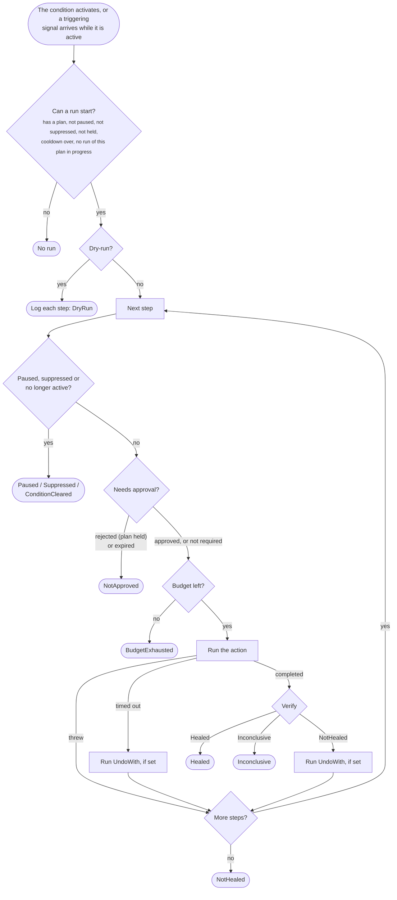

# Healing plans

A healing plan is what Homeostat does when a condition becomes active: an ordered list of steps, each an action
followed by verification. This page covers how a run moves through the steps, approvals, verification, compensation
and the plan settings.

```csharp
.Heal(p => p
    .With<RenewFeedClientAction>()          // step 1
        .ActionTimeout(TimeSpan.FromSeconds(10))
    .Then<SwitchToBackupProviderAction>()   // step 2, only if step 1 did not heal
        .VerificationTimeout(TimeSpan.FromSeconds(45))
    .Cooldown(TimeSpan.FromMinutes(10)))
```

`ActionTimeout`, `VerificationTimeout`, `RequireApproval`, `UndoWith` and `HoldAtMost` apply to the step added just
before them. `Cooldown`, `CooldownBackoff`, `VerifyWith`, `OncePerCluster` and `Adaptive` apply to the whole plan.
`With` and `Then` both append a step; use `With` for the first one and `Then` for the next ones so the plan reads
naturally.

## How a run works



Key behaviors:

- Steps run in order; at most one run per condition at a time. A `OncePerCluster()` plan also takes a cluster lease
  first and does not start if another instance holds it.
- An action that throws or times out counts as a failed step: Homeostat escalates to the next step without
  verifying.
- `Inconclusive` stops the run: no blind escalation.
- When every step has been tried, Homeostat logs an error asking for manual intervention.
- Before each step, and again after an approval, a paused Homeostat, a pending or active cause (`SuppressedBy`) or a
  condition that is no longer active stops the run.
- If the store cannot be reached to check the budget, the step does not run and the run ends with `Failed`.
- In dry-run, the run only logs each step it would execute and ends with `DryRun`.

## Human in the loop: `RequireApproval`

Some steps are too risky to run unattended: failing over to another region, restarting a component that
serves every user, purging a cache that is expensive to rebuild. Mark them, and Homeostat asks a person first:

```csharp
.Heal(p => p
    .With<RenewFeedClientAction>()                       // automatic
    .Then<SwitchToBackupProviderAction>()
        .RequireApproval(TimeSpan.FromMinutes(10)))      // needs a yes within 10 minutes
```

`RequireApproval` applies to the step added just before it. When the run reaches that step:

1. Homeostat creates a request (`PendingApproval`, with an `Id` and an expiry), logs it and notifies
   observers through `OnApprovalRequested`; the [webhook notifier](notifications.md) can post it to a chat.
2. The run waits. A person answers with `await approvals.ApproveAsync(id, "name")` or
   `await approvals.RejectAsync(id, "name")` (`IHomeostatApprovals`), through the
   [ASP.NET Core endpoints](aspnetcore.md) (`POST /homeostat/approvals/{id}/approve`) or with the
   [CLI](tools.md#command-line-tool) (`homeostat approve <id>`).
3. Approved: Homeostat checks again that it is not paused or suppressed and that the condition is still active,
   then runs the step normally (budget, timeout, verification).
4. Rejected: the run stops with outcome `NotApproved`, without trying further steps, and the plan is **held**: it
   does not run again, not even after the cooldown, until the condition clears or someone
   [releases the hold](#releasing-a-hold). A person has taken over.
5. Expired: the run stops with `NotApproved`; after the cooldown, a new triggering signal starts the plan again from
   the first step.
6. Condition cleared while waiting: the request is withdrawn (`ApprovalStatus.Canceled`) and the run ends with
   `ConditionCleared`. Requests are also withdrawn when the application stops.

Things to know:

- The default timeout is `HomeostatOptions.DefaultApprovalTimeout` (15 minutes).
- Requests live in the [store](persistence-and-clusters.md#shared-control-state): `await approvals.GetPendingAsync()`
  lists them, and any instance can answer them. With a shared store, the answer reaches the instance whose run waits
  within `ControlRefreshInterval` (5 seconds by default). Of two answers given at the same time, only the first counts.
- Built-in platform steps that take `requireApproval: true` (such as `RestartPod`) use the default timeout; call
  `.RequireApproval(timeout)` after the step to change it.
- The budget is consumed only when the step actually runs.
- If the store cannot be reached to create the request, the step does not run and the run ends with `NotApproved`,
  without holding the plan.
- While waiting, the run gives its concurrency slot back, so other plans can heal in the meantime.
- The request carries the `TriggeringSignal`, so the approver sees what started the run.
- In dry-run, the log says the step *would request approval*; no request is created.
- Approval works well with the gradual rollout: dry-run first, then approval on every risky step, then
  automatic once you trust the plan.

### Releasing a hold

A rejection usually means a person took over. When that person fixed the cause by hand and wants the plan to act
again without waiting for the condition to clear, release the hold:

```csharp
await control.ReleaseHoldAsync("weather-feed-down");   // IHomeostatControl; false if no condition with a plan has this name
```

```bash
curl -X POST -H "X-Requested-With: curl" https://weather-api.internal/homeostat/conditions/weather-feed-down/release
homeostat release weather-feed-down
```

Releasing lifts the hold and resets the cooldown backoff. For a `OncePerCluster()` plan it releases the shared plan
state; for an instance plan, the plan state of the instance that answers. The endpoint answers `204`, `404` for an
unknown condition or one without a plan, and `503` when the store cannot be reached.

## Writing actions

Besides action classes, plans accept inline lambdas and built-in actions (restart a hosted service, reload
configuration, turn on a switch). See [Actions](actions.md).

```csharp
public sealed class SwitchToBackupProviderAction(
    WeatherFeedClient client,
    ILogger<SwitchToBackupProviderAction> logger) : IHealingAction
{
    public async Task ExecuteAsync(HealingContext context, CancellationToken cancellationToken)
    {
        logger.LogWarning("Failing over: {Condition} triggered by {Source}.",
            context.ConditionName, context.TriggeringSignal.Source);

        await client.SwitchToBackupAsync(cancellationToken);   // your own logic
    }
}
```

Guidelines:

| Do | Why |
|---|---|
| Keep actions idempotent | A plan may run the same action again after its cooldown |
| Keep them short | Each action is bounded by a timeout (30 s by default) |
| Honor the cancellation token | It fires on timeout and on application shutdown |
| Order steps from least to most invasive | Escalation goes in one direction |
| Let exceptions propagate | Homeostat logs them and escalates; no need to swallow them |
| Pass the token to what you call | So a timeout or shutdown stops the work. A cancellation from your own timeouts (for example `HttpClient.Timeout`) is logged as an exception rather than a timeout; either way the step fails |

### Dependency injection

`With<T>()` and `Then<T>()` register `T` as transient if it is not registered yet. Every step runs in its own DI
scope, so actions can depend on scoped services such as a `DbContext`. To use a different lifetime, register the
action yourself before calling `AddHomeostat`.

### `HealingContext`

| Property | Content |
|---|---|
| `ConditionName` | Name of the condition being healed |
| `TriggeringSignal` | The signal that started this run: the activating signal, or the latest triggering signal for a retry after cooldown |
| `Step` | Zero-based index of the current step |
| `StepName` | Name of the current step |
| `StartedAt` | When the current step started |
| `ActionCompletedAt` | When the action completed (set before verification) |
| `Services` | Services from the step's scope |
| `GetConditionState()` | Current snapshot of the condition |

## Verification

### Default: wait for the condition to clear

Unless you configure otherwise, Homeostat uses `ConditionClearedVerifier`. After the action it polls the condition
(every `VerificationPollInterval`, default 1 s) until the timeout (default 1 minute):

| What it sees | Outcome |
|---|---|
| The condition is no longer `Active` (cleared, or already `Pending` again in a new episode) | `Healed` |
| Timeout, the condition is still active, and a signal arrived after the action | `NotHealed` |
| Timeout, and no signal arrived after the action | `Inconclusive` |
| Timeout while recovery is in progress (`ClearingSince` set) | Keeps waiting for up to `ClearAfter` more |

Give the verification timeout enough time for your signals to arrive. With health checks every 30 seconds, a
10-second timeout often ends up `Inconclusive`.

### Custom verifiers

When a direct check is better than waiting, implement `IHealingVerifier`:

```csharp
public sealed class FeedProbeVerifier(WeatherFeedClient client) : IHealingVerifier
{
    public async Task<VerificationOutcome> VerifyAsync(
        HealingContext context, TimeSpan timeout, CancellationToken cancellationToken)
    {
        using var cts = CancellationTokenSource.CreateLinkedTokenSource(cancellationToken);
        cts.CancelAfter(timeout);

        try
        {
            var ok = await client.FetchLatestAsync(cts.Token) is not null;   // your own probe
            return ok ? VerificationOutcome.Healed : VerificationOutcome.NotHealed;
        }
        catch (OperationCanceledException) when (!cancellationToken.IsCancellationRequested)
        {
            return VerificationOutcome.Inconclusive;   // the probe itself timed out
        }
    }
}
```

```csharp
.Heal(p => p
    .With<RenewFeedClientAction>()
    .VerifyWith<FeedProbeVerifier>())
```

The verifier applies to every step of the plan and is resolved from the same scope as the action (registered as
transient if needed). Homeostat passes `VerificationTimeout` as `timeout` and the verifier must honor it, as the
example does. Homeostat stops waiting after twice the timeout plus the condition's `ClearAfter`, cancels the token and
counts the step as `Inconclusive`.

If a verifier throws, the error is logged, the step is reported with verification `Inconclusive` and the exception in
`Error`, and the run stops without escalating. A verifier that returns a value outside `VerificationOutcome` (for
example `default(VerificationOutcome)`) is treated the same way: the value is logged as an error and the step counts
as `Inconclusive`. Verifiers are easy to unit test with `HealingContextFactory` from
[Homeostat.Testing](testing.md).

## Cooldown backoff

A plan that keeps failing should try less often, not at the same pace forever:

```csharp
.Heal(p => p
    .With<RenewFeedClientAction>()
    .Cooldown(TimeSpan.FromMinutes(5))
    .CooldownBackoff(2, TimeSpan.FromHours(1)))   // after failed runs: 10 min, 20, 40, then every hour
```

After each run in a row that ends `NotHealed`, `Inconclusive` or `Failed`, the cooldown is multiplied by the factor
(at least 1), up to the maximum; the backoff never makes the cooldown shorter than `Cooldown`. Other outcomes leave the
count as it is. A `Healed` run, the condition clearing or a released hold resets it. The count is part of the
[plan state](persistence-and-clusters.md), so it survives restarts with a persistent store.

## Compensation: `UndoWith`

Some actions change the system in a way you do not want to keep if they did not help: switching to a backup
provider that is no better, raising a limit, disabling a feature. Give such a step a compensating action:

```csharp
.Heal(p => p
    .With<SwitchToBackupProviderAction>().UndoWith<SwitchToPrimaryProviderAction>()
    .Then<RenewFeedClientAction>())
```

When verification says `NotHealed`, or the action timed out (part of it may have taken effect: a request accepted,
then no answer), Homeostat runs the compensating action before moving to the next step, so write it to be harmless
when there is nothing to undo. It has the step's action timeout and counts in the action budget, but the
pause, the maintenance windows, an exhausted budget and an unreachable store never block it: it reverts what the run
just changed, and leaving that in place would keep the application degraded. Its success is reported in
`HealingStepResult.UndoSucceeded`. It does not run when the action threw (it may have refused on purpose, for example
an origin someone else disabled), when verification is `Healed` (the change helped) or `Inconclusive` (Homeostat cannot
tell, and stops), nor when the application stops during the step.

## Once per cluster

With several instances, `.OncePerCluster()` makes a plan run on one instance at a time, with a cooldown shared
by the cluster. It needs a distributed coordinator and store, such as `Homeostat.Redis`. See
[Persistence and clusters](persistence-and-clusters.md#cluster-plans-oncepercluster).

## Run outcomes

| Outcome | Meaning |
|---|---|
| `Healed` | A step was verified as healed |
| `NotHealed` | Every step was tried without success |
| `Inconclusive` | Verification found no evidence either way, or the verifier threw or did not return; no escalation |
| `DryRun` | Steps were logged, not executed |
| `BudgetExhausted` | The global action budget was used up |
| `Paused` | Homeostat was paused during the run |
| `NotApproved` | A step requiring approval was rejected, expired, or could not be requested because the store was unreachable |
| `Suppressed` | A cause listed in `SuppressedBy` became pending or active during the run |
| `ConditionCleared` | The condition cleared before the next step started |
| `Canceled` | The application stopped during the run |
| `Failed` | An unexpected error interrupted the run, or the store could not be reached to check the action budget |

## Plan settings

Settings of the previous step:

| Method | Default (from options) | Meaning |
|---|---|---|
| `ActionTimeout(t)` | `DefaultActionTimeout` = 30 s | Maximum duration of the previous step's action, and of its compensating action |
| `VerificationTimeout(t)` | `DefaultVerificationTimeout` = 1 min | Time allowed for verification after the previous step's action |
| `RequireApproval(t?)` | `DefaultApprovalTimeout` = 15 min | The previous step waits for a person's approval |
| `UndoWith<T>()`, `UndoWith(name, action)` | none | Compensates the previous step when it does not heal or times out |
| `HoldAtMost(t)` | none | Turns the switch of the previous step off after `t` even if the condition has not cleared ([Actions](actions.md#turnonswitchname-and-ihomeostatswitches)) |

Called before any step, these methods throw `InvalidOperationException`. Settings of the whole plan:

| Method | Default (from options) | Meaning |
|---|---|---|
| `Cooldown(t)` | `DefaultCooldown` = 5 min | Minimum time between the end of a run and the next run of this plan |
| `CooldownBackoff(multiplier, max)` | no backoff | Grows the cooldown after runs that do not heal |
| `VerifyWith<T>()` | `ConditionClearedVerifier` | [Verifier](#custom-verifiers) used after every step of the plan |
| `Adaptive(minimumAttempts)` | declared order; `minimumAttempts` = 5 | Orders steps by measured success before each run ([Adaptive plans](intelligence.md#adaptive-plans)) |
| `OncePerCluster()` | every instance | One instance at a time, shared cooldown |

All durations must be positive (`Cooldown` can be zero) and at most about 49 days; invalid values throw
`ArgumentOutOfRangeException` when the plan is configured.

See also: [Conditions](conditions.md), [Actions](actions.md), [Guardrails](guardrails.md),
[Persistence and clusters](persistence-and-clusters.md).
