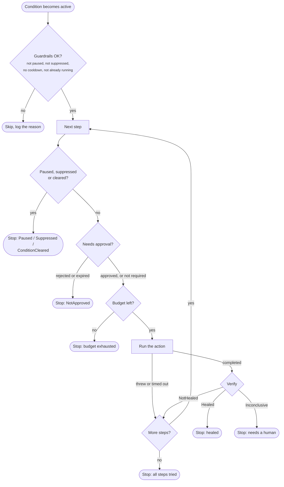

# Healing plans

A healing plan is **what Homeostat does** when a condition becomes active: an ordered list of actions,
each followed by verification.

```csharp
.Heal(p => p
    .With<RenewFeedClientAction>()          // step 1
    .Then<SwitchToBackupProviderAction>()   // step 2, only if step 1 did not heal
    .VerificationTimeout(TimeSpan.FromSeconds(45))
    .ActionTimeout(TimeSpan.FromSeconds(10))
    .Cooldown(TimeSpan.FromMinutes(10)))
```

## How a run works



Key behaviors:

- Steps run **in order**; at most one run per condition at a time.
- An action that **throws or times out** counts as a failed step: Homeostat escalates to the next step
  without verifying.
- `Inconclusive` **stops** the run: no blind escalation.
- When every step has been tried, Homeostat logs an error asking for manual intervention.
- Before each step, a paused Homeostat, an active cause (`SuppressedBy`) or a condition that has already
  cleared stops the run.
- In **dry-run**, the run only logs each step it would execute and stops there.

## Human in the loop: `RequireApproval`

Some steps are too risky to run unattended: failing over to another region, restarting a component that
serves every user, purging a cache that is expensive to rebuild. Mark them, and Homeostat asks a person first:

```csharp
.Heal(p => p
    .With<RenewFeedClientAction>()                       // automatic
    .Then<SwitchToBackupProviderAction>()
        .RequireApproval(TimeSpan.FromMinutes(10)))      // needs a yes within 10 minutes
```

`RequireApproval` applies to the step added just before it. When the run reaches that step:

1. Homeostat creates a request (`PendingApproval`, with an `Id` and an expiry), logs it and notifies
   observers through `OnApprovalRequested`; the [webhook notifier](notifications.md) can post it to a chat.
2. The run waits. A person answers with `IHomeostatApprovals.Approve(id, "name")` or `Reject(id, "name")`,
   or through the [ASP.NET Core endpoints](aspnetcore.md) (`POST /homeostat/approvals/{id}/approve`).
3. **Approved**: Homeostat checks again that it is not paused or suppressed and that the condition is still
   active, then runs the step normally (budget, timeout, verification).
4. **Rejected**: the run stops with outcome `NotApproved`, without trying further steps, and the plan is
   **held**: it does not run again, not even after the cooldown, until the condition clears. A person has taken
   over. **Expired**: the run stops with `NotApproved`; after the cooldown, a new triggering signal starts the
   plan again from the first step.
5. **Condition cleared while waiting**: the request is withdrawn (`ApprovalStatus.Cancelled`) and the run ends
   with `ConditionCleared`. Requests are also withdrawn when the application stops.

Things to know:

- The default timeout is `HomeostatOptions.DefaultApprovalTimeout` (15 minutes).
- The budget is consumed only when the step actually runs.
- While waiting, the run gives its concurrency slot back, so other plans can heal in the meantime.
- The request carries the `TriggeringSignal`, so the approver sees what started the run.
- In dry-run, the log says the step *would request approval*; no request is created.
- Approval works well with the gradual rollout: dry-run first, then approval on every risky step, then
  automatic once you trust the plan.

## Writing actions

> Besides action classes, plans accept inline lambdas and built-in actions
> (restart a hosted service, reload configuration, turn on a switch). See [Actions](actions.md).

```csharp
public sealed class SwitchToBackupProviderAction(
    WeatherFeedClient client,
    ILogger<SwitchToBackupProviderAction> logger) : IHealingAction
{
    public async Task ExecuteAsync(HealingContext context, CancellationToken cancellationToken)
    {
        logger.LogWarning("Failing over: {Condition} triggered by {Source}.",
            context.ConditionName, context.TriggeringSignal.Source);

        await client.SwitchToBackupAsync(cancellationToken);   // your own logic
    }
}
```

Guidelines:

| Do | Why |
|---|---|
| Keep actions **idempotent** | A plan may run the same action again after its cooldown |
| Keep them **short** | Each action is bounded by a timeout (30 s by default) |
| **Honor the cancellation token** | It fires on timeout and on application shutdown |
| Order steps from **least to most invasive** | Escalation goes in one direction |
| Let exceptions propagate | Homeostat logs them and escalates; no need to swallow them |
| **Pass the token to what you call** | So a timeout or shutdown actually stops the work. A cancellation from your own timeouts (e.g. `HttpClient.Timeout`) is logged as an exception rather than a timeout; either way the step fails |

### Dependency injection

`With<T>()` and `Then<T>()` register `T` as **transient** if it is not registered yet. Every step runs
in its **own DI scope**, so actions can depend on scoped services such as a `DbContext`. To use a
different lifetime, register the action yourself before calling `AddHomeostat`.

### `HealingContext`

| Property | Content |
|---|---|
| `ConditionName` | Name of the condition being healed |
| `TriggeringSignal` | The signal that started this run: the activating signal, or the latest triggering signal for a retry after cooldown |
| `Step` | Zero-based index of the current step |
| `StepName` | Name of the current step |
| `StartedAt` | When the current step started |
| `ActionCompletedAt` | When the action completed (set before verification) |
| `Services` | Services from the step's scope |
| `GetConditionState()` | Current snapshot of the condition |

## Verification

### Default: wait for the condition to clear

Unless you configure otherwise, Homeostat uses `ConditionClearedVerifier`. After the action it polls
the condition (every `VerificationPollInterval`, default 1 s) until the timeout (default 1 minute):

| What it sees | Outcome |
|---|---|
| The condition cleared | `Healed` |
| Timeout, and signals arrived after the action still show the problem | `NotHealed` |
| Timeout, and no signal arrived after the action | `Inconclusive` |

Make sure the verification timeout gives your signals time to arrive. With health checks every
30 seconds, a 10-second timeout will often end up `Inconclusive`.

### Custom verifiers

When a direct check is better than waiting, implement `IHealingVerifier`:

```csharp
public sealed class FeedProbeVerifier(WeatherFeedClient client) : IHealingVerifier
{
    public async Task<VerificationOutcome> VerifyAsync(
        HealingContext context, TimeSpan timeout, CancellationToken cancellationToken)
    {
        using var cts = CancellationTokenSource.CreateLinkedTokenSource(cancellationToken);
        cts.CancelAfter(timeout);

        try
        {
            var ok = await client.FetchLatestAsync(cts.Token) is not null;   // your own probe
            return ok ? VerificationOutcome.Healed : VerificationOutcome.NotHealed;
        }
        catch (OperationCanceledException) when (!cancellationToken.IsCancellationRequested)
        {
            return VerificationOutcome.Inconclusive;   // the probe itself timed out
        }
    }
}
```

```csharp
.Heal(p => p
    .With<RenewFeedClientAction>()
    .VerifyWith<FeedProbeVerifier>())
```

The verifier applies to every step of the plan and is resolved from the same scope as the action.
Homeostat does not enforce `VerificationTimeout` on custom verifiers: it is passed as `timeout`, and the
verifier must honor it, as the example does. If a verifier throws, the error is logged, the step is reported
with verification `Inconclusive` and the exception in `Error`, and the run stops without escalating.
Verifiers are easy to unit test with `HealingContextFactory` from [Homeostat.Testing](testing.md).

## Run outcomes

| Outcome | Meaning |
|---|---|
| `Healed` | A step was verified as healed |
| `NotHealed` | Every step was tried without success |
| `Inconclusive` | Verification found no evidence either way; no escalation |
| `DryRun` | Steps were logged, not executed |
| `BudgetExhausted` | The global action budget was used up |
| `Paused` | Homeostat was paused during the run |
| `NotApproved` | A step requiring approval was rejected or expired |
| `Suppressed` | A cause listed in `SuppressedBy` became active during the run |
| `ConditionCleared` | The condition cleared before the next step started |
| `Cancelled` | The application stopped during the run |
| `Failed` | An unexpected error interrupted the run |

## Plan settings

| Method | Default (from options) | Meaning |
|---|---|---|
| `VerificationTimeout(t)` | `DefaultVerificationTimeout` = 1 min | Time allowed for verification after each action |
| `ActionTimeout(t)` | `DefaultActionTimeout` = 30 s | Maximum duration of each action |
| `Cooldown(t)` | `DefaultCooldown` = 5 min | Minimum time between the end of a run and the next run of this plan |
| `RequireApproval(t?)` | `DefaultApprovalTimeout` = 15 min | The previous step waits for a person's approval |
