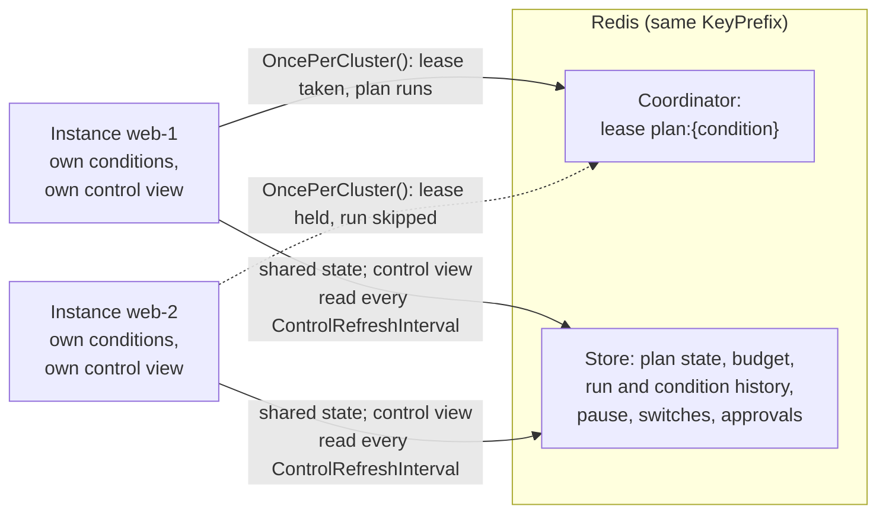

# Persistence and clusters

This page covers where Homeostat keeps its state and how several instances of an application share it. By default
Homeostat keeps its state in memory and every instance acts on its own, which is right for a single instance that can
forget everything on restart. For anything else, choose a store (where the state lives) and, for several instances,
decide which plans run once per cluster. The last section is the contract for writing your own store.

## What is stored

| State | Why it matters |
|---|---|
| Plan state: end of the last run, failures in a row, held after a rejection, the instance that ran it last | Cooldowns, [backoff](healing-plans.md#cooldown-backoff) and holds survive restarts and apply across instances |
| Action budget | A restart does not reset the budget; with a shared store, the budget is shared by every instance |
| Run history | `GetRecentRunsAsync()` and the status endpoint show what happened, on every instance, before the restart |
| Condition history: activations and clears, with the signal that caused them | `GetConditionHistoryAsync()`, `GET /homeostat/history`, the dashboard and the coverage reports see every instance, across restarts (`ConditionHistorySize`, 200 events by default). Events written while the store is down are retried every 30 seconds |
| Documents: small JSON documents kept by features, such as the learned baselines of [seasonal rules](conditions.md#seasonal-anomalies-whenseasonallyhigh-and-whenseasonallylow) | A deployment does not throw away weeks of learning |
| Pause: who paused, when, and until when | With a shared store, a pause given on one instance stops every instance |
| Application switches: who turned them on, and the condition that owns them, if any | A switch turned on through any instance is on for all of them |
| Approval requests, pending or answered | Any instance lists and answers them; the answer reaches the instance whose run waits for it |

The current state of the conditions (pending, active, clearing) is **not** stored: it is rebuilt from fresh signals
within a few detection intervals, which is what you want after a restart. The history of what they did is.

## Shared control state

The pause, the application switches and the approval requests form the control state. Every instance keeps a
view of it in memory, read from the store at startup, every `HomeostatOptions.ControlRefreshInterval` (5 seconds by
default) and right after every change made on that instance. `IsPaused` and `IsOn` read the view, so they never wait
for the store. A change made on another instance applies here within one refresh interval; an answer to an approval
request reaches the waiting instance within the same delay. When the store cannot be read, the instance keeps its
last known view and logs a warning. Until the view has been read once (at startup, with the store unreachable),
Homeostat counts as paused, with the reason "waiting for the control state from the store": it cannot know whether a
pause is in place. A change written here whose read-back fails still applies here at once.

```csharp
await control.PauseAsync(until: time.GetUtcNow().AddMinutes(20), by: "deploy");   // every instance, within 5 s
await switches.TurnOnAsync("serve-cached-forecast");                            // SwitchScope.Application
await switches.TurnOnAsync("verbose-client-logs", SwitchScope.Instance);        // this instance only
```

Switches have a scope (`SwitchScope`):

| Scope | Where it is on | Kept |
|---|---|---|
| `Application` (default of `TurnOnAsync`) | Every instance that shares the store | In the store |
| `Instance` | The instance that turned it on | In its memory, until it stops |

`TurnOffAsync` turns a switch off for the application and for the instance that calls it; a switch that another
instance turned on for itself stays on there. `IsOn` and `GetActive()` cover both scopes, and `Changed` is raised for
application switches changed on other instances too.

The [`TurnOnSwitch`](actions.md#turnonswitchname-and-ihomeostatswitches) step picks the scope from the plan:

- in a `OncePerCluster()` plan it turns on an application switch, on every instance. With
  `turnOffWhenCleared: true` (the default) the condition owns the switch, and the switch is turned off when the
  condition clears on the instance that ran the plan, as for the plan state (if that instance stops first, turn the
  switch off by hand, or let the plan run again elsewhere: it then takes the switch over). The store claims and
  releases it atomically, so a switch a person turned on, even a moment before on another instance, stays theirs;
- in any other plan it turns on an instance switch, turned off when the condition clears on that instance.

Which store keeps what:

| Store | Pause | Switches turned on by a person or by code | Switches owned by a condition | Approval requests |
|---|---|---|---|---|
| In memory | Until the process stops | Until the process stops | Until the process stops | Until the process stops |
| File | Across restarts | Across restarts | Not kept: the condition starts again from scratch | Not kept: the run that waits does not survive a restart |
| Redis | Shared, across restarts | Shared, across restarts | Shared | Shared |

Requests whose instance stopped before collecting the answer are dropped a day after they expired (by the Redis store
when it reads the control state, by the in-memory and file stores when a new request is added). An answer to an
approval that the store does not confirm in time is checked once more: if the store recorded it, the call succeeds;
if it recorded another answer, the call returns `false`; otherwise it throws a `TimeoutException` saying the outcome is
unknown, since the store may still apply it.

When the store cannot be reached, a change that lets Homeostat act (resume, turn a switch on, answer an approval,
release a hold) fails, with `503` from the control endpoints: it was not made. A change in the safe direction (pause,
turn a switch off, release a switch Homeostat turned on) applies at once on the instance where it is made. That
instance writes it to the store at every refresh until the store takes it, unless the store shows a newer decision by
then (see [ASP.NET Core](aspnetcore.md#control)).

Every change carries the time it was decided, by the clock of the instance where it was made, and the store keeps the
latest decision about the pause and about each switch. **Keep the clocks of the instances synchronized (NTP)**: an
instance whose clock is ahead takes decisions that look later than they are. When the store refuses a change in the
safe direction because it holds a later decision (for example a pause written after a resume decided later on another
instance), the instance logs a warning that names what the store holds (`Homeostat resumed by a decision taken after
this pause`, or the switch and who turned it on), and the change stops applying there at its next read of the store. A
refusal that loses nothing (the switch was already off, a later pause is in place) is logged at debug level only.

A switch that a cluster plan turned on is renewed by the instance that holds it, every 3 refresh intervals, and the
claim records that period (`SwitchState.RenewInterval`). If that instance stops or crashes, another instance turns the
switch off as soon as the condition is not active there: at once when the instance stopped cleanly, otherwise once the
claim has not been renewed for 4 renewal periods (12 refresh intervals, at least one minute). The observing instance
uses the longer of its own period and the owner's, plus 30 seconds for the difference between the clocks, so an
instance configured with a longer `ControlRefreshInterval` keeps its switch; a claim written by an older version
without the period is judged by the observer's own. See [Actions](actions.md).

## Choosing a store

| Store | Package | Use it when |
|---|---|---|
| In memory (default) | `Homeostat` | One instance, state can be lost on restart |
| File | `Homeostat` | One instance that must remember cooldowns, budget and history across restarts |
| Redis | `Homeostat.Redis` | Several instances, or any deployment that already has Redis |
| Your own | Your code | Implement `IHomeostatStore` (for example on your database) and register it with `UseStore<T>()` |

```csharp
// One instance, state in a file (written atomically after every change)
.AddHomeostat(h => h.UseFileStore("data/homeostat.json"))

// Several instances (dotnet add package Homeostat.Redis --prerelease). abortConnect=false (AbortOnConnectFail = false):
// the application starts while Redis is down, and the client reconnects in the background.
builder.Services.AddSingleton<IConnectionMultiplexer>(_ => ConnectionMultiplexer.Connect("redis:6379,abortConnect=false"));
builder.Services.AddHomeostat(h => h.UseRedis(o => o.KeyPrefix = "weather-api:homeostat:"));
```

### File store

The file store writes atomically (temporary file, flushed, then renamed). A change that cannot be written (a full
disk, a read-only volume) fails and is undone in memory too, so what the store reports always matches the file. A
file that cannot be read (bad JSON, or null records from a hand edit) is renamed to `*.corrupt` and the store starts
empty but **paused**, with the reason `store file unreadable (set aside as ...)`, and logs a critical error: the file may
have held a person's pause, so Homeostat does not act until a person resumes it on purpose. The new file with that
pause is written before the old one is set aside; if it cannot be written, the store does not open and is tried again
later. While open, the store holds an exclusive lock on `{path}.lock`: a second process opening the same file (the
old and new process of a rolling deploy on a shared volume) fails at startup with a clear error instead of
overwriting the other's state. Use a path that survives a restart (a volume, in a container) and that only the
application's user can write.

```csharp
.AddHomeostat(h => h.UseFileStore("data/homeostat.json", o => o.PlanStateRetention = TimeSpan.FromDays(90)))
```

| `FileStoreOptions` | Default | Meaning |
|---|---|---|
| `PlanStateRetention` | 30 days | How long the cooldown and backoff state of a plan that no longer runs is kept. Older entries (renamed conditions, former instance names) are dropped when the file is loaded, so the file does not grow forever. Held plans, and plans that never completed a run, are always kept |

### Redis store

`UseRedis()` uses the `IConnectionMultiplexer` already registered in your container; `UseRedis("redis:6379")`
creates one, with `abortConnect=false`, if none is registered. Register yours with `AbortOnConnectFail = false` too:
otherwise resolving it blocks a thread for the whole connect timeout while Redis is down. The connection is resolved
on first use, so the application starts while Redis is unreachable; Homeostat stays paused until it can read the
control state. A resolution that fails is tried again after 10 seconds, not on every store call. A pause record that
cannot be read (written by another version, or damaged) counts as a pause that lasts until a person resumes, with the
reason `unreadable pause record in the store`, never as "not paused"; it is logged as critical. Instances
with the same `KeyPrefix` share their state: use one prefix per application and environment. `UseRedis` also
registers the Redis coordinator, so `OncePerCluster()` plans coordinate every instance.

| `RedisStoreOptions` | Default | Meaning |
|---|---|---|
| `KeyPrefix` | `homeostat:` | Prefix of every key; instances that share it share cooldowns, budget, history and leases. Cannot be empty |
| `ShareBudget` | `true` | One action budget for every instance; `false` counts it per instance |
| `PlanStateRetention` | 7 days | How long plan state is kept after its last change; refreshed at every run. A held plan is kept until its hold ends. Must be positive |
| `DocumentRetention` | 90 days | How long documents (such as seasonal baselines) are kept after their last update. Must be positive |

### When the store fails

Homeostat **fails closed**: if it cannot read a plan's cooldown, consume the budget or, for a cluster plan, reach the
coordinator, it does not run the plan, and logs an error (at most once a minute per condition). A failure to write
the history is only a warning, and the status endpoint keeps working, reporting the store error instead of budget
and runs. Pair a shared store with the
[Homeostat health check](aspnetcore.md#homeostat-as-a-health-check), which reports the store as unavailable.

## Several instances

Each instance runs its own Homeostat: it receives its own signals and tracks its own conditions. What changes is
where the plans run.



Every instance tracks its own conditions, reads and writes the same store, and keeps its own view of the control
state. A cluster plan runs only on the instance that gets its lease.

### Instance plans (default)

Every instance heals its own copy of the problem: a stuck client in instance A is renewed by instance A. With a
shared store, each instance has its own cooldown and backoff (keys are prefixed with
`HomeostatOptions.InstanceId`), while the budget and the history are shared.

### Cluster plans: `OncePerCluster()`

Some problems are shared by all instances, and so is the fix: failing over to a backup provider, purging a shared
cache, scaling a dependency. Ten instances must not do it ten times.

```csharp
.AddCondition("forecast-provider-down", c => c
    .ForSource("http:forecast")
    .SustainedFor(TimeSpan.FromSeconds(30))
    .Heal(p => p
        .With<SwitchToBackupProviderAction>()
        .OncePerCluster()))
```

A cluster plan:

1. takes a lease named `plan:{condition}` from the `IHomeostatCoordinator`; an instance that does not get it skips
   the run (the plan is running elsewhere), and an instance that cannot reach the coordinator does not start it;
2. reads and writes a shared plan state, so the cooldown applies to the whole cluster;
3. keeps the lease alive while the run lasts (the Redis coordinator renews it at a third of `ClusterLeaseDuration`,
   default 1 minute), and releases it at the end. If the instance dies, the lease expires and another instance can
   take over;
4. **stops before its next step if the lease may have been lost**. The run ends `Canceled`. The Redis coordinator
   declares the lease lost before the key can expire: when it could not renew it and less than a sixth of the lease
   duration is left (a margin for clock differences and for the run to notice), for example during a long Redis
   outage or severe thread pool starvation;
5. if the plan state cannot be saved at the end of the run (the store is down), keeps the lease for the cooldown
   instead of releasing it: the cooldown then exists only in this instance's memory, and releasing the
   lease would let another instance run the plan again at once.

When the condition clears, only the instance that ran the plan last resets the shared hold and backoff: one
instance that recovers does not lift a rejection that concerns the whole cluster. To lift a hold earlier, use
`IHomeostatControl.ReleaseHoldAsync(condition)` (see [Human in the loop](healing-plans.md#human-in-the-loop-requireapproval)).
Each instance caches a hold it has read and reads it again from the store after a minute, so a hold lifted on another
instance applies everywhere within a minute; `ReleaseHoldAsync` lifts it at once on the instance that calls it.

> [!WARNING]
> Leases are not fencing tokens: an action that is already running when the lease is lost finishes. Keep cluster
> actions idempotent, and keep `ClusterLeaseDuration` well above the time a single step takes.

With the default in-process coordinator (`InMemoryCoordinator`), "cluster" means the process, and its leases are
never lost: use `UseRedis` (or your own coordinator) for real coordination.

### Writing your own coordinator

To coordinate through something you already run (a database, a lock service), implement `IHomeostatCoordinator` and
register it with `UseCoordinator<T>()` (a singleton) or `UseCoordinator(sp => ...)`. Pair it with a store that every
instance shares, since cluster plans read and write their state there.

```csharp
public sealed class DatabaseLeaseCoordinator(LeaseTable leases) : IHomeostatCoordinator
{
    public async ValueTask<IHomeostatLease?> TryAcquireAsync(string resource, TimeSpan duration, CancellationToken cancellationToken = default)
    {
        var token = Guid.NewGuid().ToString("N");
        return await leases.TryInsertAsync(resource, token, duration, cancellationToken)   // your code: insert if absent or expired
            ? new DatabaseLease(leases, resource, token, duration)
            : null;                                                                       // held elsewhere: the run is skipped
    }
}
```

```csharp
.AddHomeostat(h => h.UseStore<DatabaseStore>().UseCoordinator<DatabaseLeaseCoordinator>())
```

The contract:

- `TryAcquireAsync` returns `null` when another holder has the lease, and never waits for it.
- The returned `IHomeostatLease` keeps the lease alive until it is disposed: renew it in the background (the Redis
  coordinator renews at a third of `duration`), and release it in `DisposeAsync`. A holder that dies must let the
  lease expire after `duration`.
- `IHomeostatLease.Lost` is a `CancellationToken` canceled when the lease may have been lost (it could not be renewed
  in time). Homeostat then stops the run before its next step, with outcome `Canceled`.
- Renewal and release must check that the lease is still yours (compare the token), so a late instance does not
  extend or delete the lease of the next holder.

### Instance identity

`HomeostatOptions.InstanceId` defaults to the machine name: stable across restarts (so the file store finds the
state of instance plans again) and, in containers, the pod or container name. It appears in run records, in the
status endpoint, in traces (`homeostat.instance`), in the keys of instance plans and in approval requests (the
instance whose run waits for the answer). Set it explicitly when several processes on the same machine share a store,
or when your platform gives instances a better name.

Keep it stable across restarts: a new name starts with an empty cooldown and backoff for its instance plans. In
Kubernetes, a StatefulSet gives each pod a stable name; a Deployment gives a new name to every new pod.

## Redis keys

| Key | Type | Content |
|---|---|---|
| `{prefix}plan:{key}` | hash | `ended`, `failures`, `held`, `by`; updated by an atomic script; expires after `PlanStateRetention` (7 days) without changes, except while the plan is held |
| `{prefix}budget` | sorted set | One member per action, scored by time; updated by an atomic script |
| `{prefix}runs` | list | Run records as JSON, newest first, trimmed to `RunHistorySize` |
| `{prefix}lease:plan:{condition}` | string | Lease token, with an expiry |
| `{prefix}conditions` | list | Condition events as JSON, newest first, trimmed to `ConditionHistorySize` |
| `{prefix}doc:{key}` | string | A document, such as `doc:baseline:{condition}:{cycle}`; expires after `DocumentRetention` (90 days) without updates |
| `{prefix}{control}:pause` | string | The pause as JSON (`until`, `by`, `at`) |
| `{prefix}{control}:switches` | hash | Application switches by name, as JSON (`name`, `condition`, `instance`, `by`, `at`, `renewedAt`, `renewInterval`); a plan claims, renews or releases one with an atomic script |
| `{prefix}{control}:approvals` | hash | Approval requests by id, as JSON, with the waiting instance |
| `{prefix}{control}:answers` | hash | Answers by request id, written by an atomic script so that only the first answer wins; removed with their request by one script |
| `{prefix}{control}:decided` | hash | When the latest decision about the pause and each switch was taken (Unix microseconds), and when a plan's claim on a switch was made and last renewed: a write that arrives late is refused |

The control keys share the hash tag `{control}`, so on Redis Cluster they are in one slot, as the approval script needs.

Set `ShareBudget = false` to count the budget per instance (`{prefix}budget:{instance}`). The budget, and the order of
decisions about the pause and the switches, use the clock of each instance: keep the clocks synchronized (NTP), as any
distributed system expects. With clocks a few seconds apart, of two decisions taken within those seconds on two
instances, the one stamped later wins. On a tie, a decision that makes Homeostat do less (a pause, a switch turned
off) wins over one that lets it act; with a simulated clock (`FakeTimeProvider`), advance it between turning a switch
off and on again.

## Writing your own store

`IHomeostatStore` has fourteen required methods, and a store you write is registered with `UseStore<T>()` or
`UseStore(sp => ...)`:

| Area | Methods |
|---|---|
| Plan state | `GetPlanStateAsync`, `UpdatePlanStateAsync` |
| Action budget | `TryConsumeBudgetAsync`, `GetBudgetUsedAsync` |
| Run history | `AppendRunAsync`, `GetRecentRunsAsync` |
| Control state | `GetControlStateAsync`, `TrySetPauseAsync`, `TrySetSwitchAsync`, `TryClaimSwitchAsync`, `TryReleaseSwitchAsync`, `AddApprovalAsync`, `TryResolveApprovalAsync`, `RemoveApprovalAsync` |

The control state uses the types `ControlState`, `PauseState`, `SwitchState` and `ApprovalRecord` of
`Homeostat.Persistence`. Six more members have default implementations, and members added after 1.0 will have them
too, with a `Supports*` property when the default does nothing, so stores written for 1.0 keep compiling:

- `SupportsConditionHistory`, `AppendConditionEventAsync`, `GetConditionEventsAsync`: the condition history. By default
  the store does not keep it (`false`), and Homeostat keeps it in process memory instead.
- `SupportsDocuments`, `GetDocumentAsync`, `SetDocumentAsync`: small documents by key (a seasonal baseline is at most
  about 150 KB of JSON), each replacing the previous one with the same key. By default nothing is kept (`false`,
  and `GetDocumentAsync` returns `null`), seasonal baselines are learned again after every restart, and Homeostat logs
  it once. The file store keeps documents until they are replaced: after renaming a seasonal condition, the old
  baseline stays in the file, unused.

Requirements:

- **Thread-safe**, and for a shared store, **atomic** plan-state updates, budget consumption and answers to approval
  requests across instances (the Redis store uses server-side scripts). Concurrent updates from several instances
  must not lose each other's changes.
  - `UpdatePlanStateAsync` applies the update as `PlanStateUpdate.ApplyTo` defines and returns the new state: fields
    left `null` are kept, and `OnlyIfLastRunBy` is a precondition (when it does not match, the state is returned
    unchanged).
  - `TryConsumeBudgetAsync` consumes one unit only if fewer than `limit` were used within the sliding `window`, and
    returns whether the action may run.
  - `TryResolveApprovalAsync` answers a request only if it is still pending: of two answers given at the same time on
    two instances, exactly one wins (`true` for the call that answered).
- **Decision order** for the pause and the switches. Every write carries the time the decision was taken
  (`decidedAt`, which is `PauseState.At` for a pause, or `SwitchState.At` for a claim). Apply it only if no later
  decision about the same pause or switch is recorded, and otherwise return `false`. A write that timed out on the
  instance but that the store runs later then cannot turn back on a switch turned off since, or end a newer pause.
  On a tie, accept a decision that makes Homeostat do less (a pause, a switch off, a release) and refuse one that
  lets it act (a resume, a switch on, a claim). Decisions about a switch include turning it on or off and a condition
  claiming or releasing it. Each operation is atomic.
- `TrySetSwitchAsync` turns an application switch on (replacing its previous state) or, with `null`, off.
- `TryClaimSwitchAsync` turns a switch on for a condition's cluster plan (`SwitchState.Condition` is set, and
  `SwitchState.At` is the decision). It applies only if the switch is owned by the same condition and was not claimed
  later since, or is off and nothing was decided about it at or after the claim. A switch that a person turned on, or
  that another condition owns, is left as it is. It returns `true` if the switch is now owned by the condition.
- A renewal of a claim (`RenewedAt` other than `At`) only updates the claim it renews: still there, made by the same
  instance at the same `At`. A renewal is not a decision: it leaves the switch's latest decision as it was, so a
  person's turn-off decided after the claim, even before the renewal, still applies. Record when the claim was last
  renewed: `TryReleaseSwitchAsync` needs it.
- `TryReleaseSwitchAsync` turns a switch off only if the condition still owns it and, when `instance` is given, that
  instance turned it on. A switch that a person took over, or that the condition claimed again or renewed after
  `decidedAt`, stays on. It returns `true` if the switch was turned off.
- `GetControlStateAsync` skips switch and approval records it cannot read rather than failing: one bad record must not
  hide the pause. A pause record it cannot read is returned as a pause without an end (fail closed), never as no pause.
- Keep `SwitchState.RenewInterval` with a claim and its renewals: other instances use it to tell a live owner from one
  that is gone.
- `GetPlanStateAsync` returns `PlanState.Empty` for unknown plans. `GetRecentRunsAsync` and `GetConditionEventsAsync`
  return the newest first; `AppendRunAsync` and `AppendConditionEventAsync` keep at most the given number of entries.
- Throw on failure: Homeostat handles it (fail closed).
- Time out your own calls (the Redis store relies on the client's timeouts). Homeostat bounds every wait and starts
  every call off the caller's thread, but a call that never returns keeps a thread until it does.

`InMemoryHomeostatStore` and the scripts of the Redis store implement this contract exactly; `InMemoryHomeostatStore`
is a good reference, and `FileHomeostatStore` shows how to persist it. Both are sealed: wrap them rather than derive
from them.

See also: [ASP.NET Core endpoints](aspnetcore.md), [Guardrails](guardrails.md), [Healing plans](healing-plans.md),
[Actions](actions.md).
